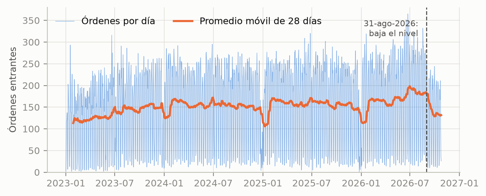
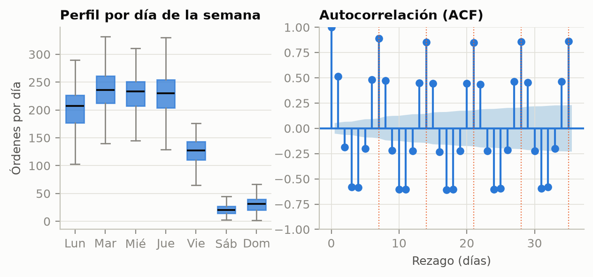
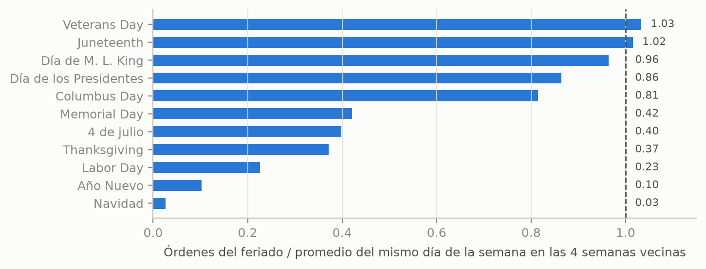
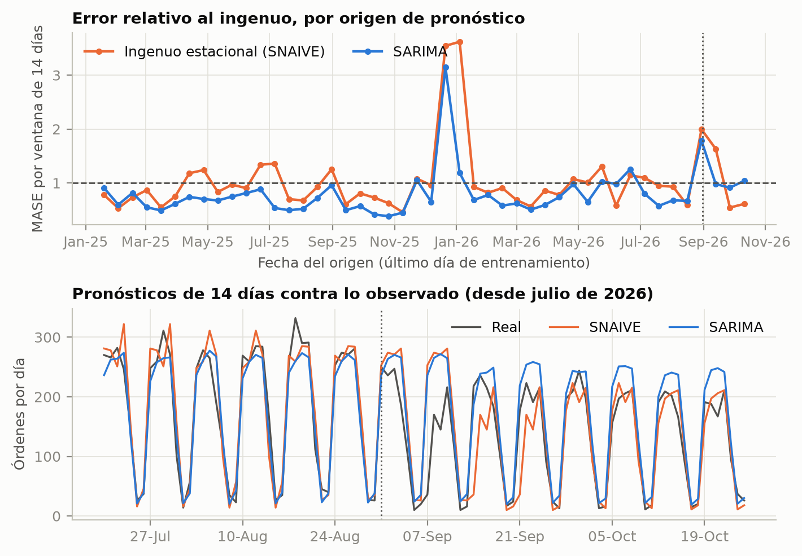

<!-- PORTADA (no cuenta en el límite de páginas) -->

**[Insertar logo de Lead University]**

**Curso:** Modelado matemático (BCD5105), III Cuatrimestre 2026

**Proyecto integrador:** Avance 1, planteamiento y primer modelo

**Título:** Pronóstico de las órdenes entrantes de LightForce Orthodontics mediante series temporales

**Grupo:** _(número)_

**Integrantes:** _(nombres completos)_

**Fecha de entrega:** 29 de octubre de 2026

**Notebook de Colab (permiso de lectura):** _(pegar el enlace compartido)_

\newpage

# 1. Introducción y planteamiento del problema

LightForce Orthodontics es una empresa de EE. UU. (fundada en 2019) que fabrica aparatos ortodónticos totalmente personalizados con impresión 3D y CAD/CAM. Su producto central es el bracket LightBracket, diseñado para cada diente de cada paciente, y vende solo a ortodoncistas. Cada pedido nace cuando el doctor envía el escaneo digital del paciente por el portal; el caso se registra en el sistema de manufactura y, desde ese momento, pasa por segmentación, planificación del tratamiento, aprobación del doctor, diseño, impresión y envío. Como cada caso es único, el trabajo no se puede inventariar: la carga del equipo depende de cuántos escaneos llegan cada día.

El problema que se aborda es **pronosticar cuántas órdenes entrantes (escaneos recibidos) llegarán cada día durante las próximas dos semanas**. Hoy el volumen es muy desigual: entre lunes y jueves entran unas 200 a 230 órdenes diarias, el viernes unas 125 y el fin de semana unas 25. A eso se suman caídas fuertes en los feriados de EE. UU. y cambios de nivel de varias semanas. Sin un pronóstico, la planificación de turnos y horas extra reacciona al volumen que ya llegó, en lugar de anticiparlo.

El contexto costarricense es directo. Tres de los cuatro supervisores de manufactura digital de la empresa trabajan en Costa Rica y desde aquí se atiende a los clientes de EE. UU. y Canadá. La demanda llega con el calendario y los horarios de EE. UU. (por eso los feriados de ese país mueven la serie), pero el trabajo lo absorbe un equipo en Costa Rica con un horario y una capacidad fijos.

# 2. Justificación

El pronóstico de la demanda diaria importa por tres razones. Primero, la capacidad del equipo es rígida a corto plazo: los técnicos trabajan un turno estándar de 9 horas (incluido el almuerzo) y las cuentas de cada doctor están asignadas a un equipo específico (Prism), de modo que un exceso de casos no se reparte automáticamente. Saber con dos semanas de anticipación si habrá un exceso o un faltante de casos permite ajustar horas extra, vacaciones y asignación entre equipos. Segundo, un caso que espera en cola alarga los tiempos de ciclo (SLA) que la empresa monitorea. Tercero, el análisis es transferible: la misma estrategia (estacionalidad semanal, efecto de feriados, validación contra un ingenuo) aplica a la demanda de otros servicios con calendario externo.

Se benefician los supervisores y planificadores de manufactura digital, que toman las decisiones de dotación; los técnicos en Costa Rica, que sufren menos picos de sobrecarga y semanas sin trabajo; y los doctores, que reciben su plan de tratamiento en menos tiempo. El impacto no se cuantifica en este avance; lo que sí se mide es cuánto mejora el pronóstico respecto de una regla simple.

# 3. Objetivos

**Objetivo general.** Modelar y pronosticar el número diario de órdenes entrantes de LightForce Orthodontics entre el 1 de enero de 2023 y el 25 de octubre de 2026 mediante modelos de series temporales, y evaluar si superan de forma consistente a un pronóstico ingenuo, para apoyar la planificación de capacidad del equipo de manufactura digital con un horizonte de 14 días.

**Objetivos específicos.**

1. Construir y depurar la serie diaria de escaneos recibidos a partir de la tabla de órdenes de manufactura (1,394 días, sin faltantes) y documentar su definición.
2. Caracterizar la tendencia, la estacionalidad semanal y el efecto de los feriados mediante estadísticas descriptivas, autocorrelación y descomposición STL.
3. Ajustar un modelo SARIMA con período semanal y compararlo, con MAE, RMSE y MASE bajo validación de ventana expansiva (46 ventanas de 14 días), contra un pronóstico ingenuo estacional y dos referencias adicionales.
4. Diagnosticar los residuos y precisar en qué situaciones falla el modelo (feriados y cambios de nivel), para fundamentar el segundo método de la entrega final.

# 4. Dataset y análisis exploratorio

**Fuente.** Base de datos analítica de LightForce Orthodontics (Databricks), tabla `analytics.manufacturing.mfg_all_orders`, consultada el 26 de octubre de 2026 con autorización de la empresa. Es una fuente interna, por lo que no tiene un enlace público; la consulta SQL exacta está en el notebook y la serie resultante se incluye en el repositorio (`datos/ordenes_diarias.csv`). Cada fila de la tabla es un caso de manufactura.

**Definición.** Una orden entrante es un caso nuevo (`order_type = 'New case'`) con fecha de recepción del escaneo (`scan_received_date`). Los reórdenes quedan fuera porque reutilizan el escaneo original. La fecha se convierte de UTC a hora del este de EE. UU. antes de contar por día. Se incluyen todas las etapas de tratamiento y todos los estados, incluso casos que luego se cancelaron, porque la demanda llegó de todos modos.

**Período.** Del 1 de enero de 2023 al 25 de octubre de 2026 (1,394 días, 210,249 órdenes, ningún día faltante). Se excluye 2019–2022 porque la empresa estaba en rampa de crecimiento (66 casos nuevos en 2019, 1,384 en 2020, 9,271 en 2021 y 29,139 en 2022), mientras que desde 2023 el volumen anual se mueve entre unos 49,000 y 57,000.

| Variable | Tipo | Unidad | Descripción |
|---|---|---|---|
| `fecha` | Fecha (índice) | Día calendario, hora ET | Día en que se recibió el escaneo |
| `ordenes` | Entero, no negativo | Órdenes por día | Casos nuevos con escaneo recibido ese día (variable a pronosticar) |
| `dia_semana` | Categórica (derivada) | Lunes a domingo | Día de la semana de `fecha` |
| `feriado_US` | Binaria (derivada) | 0/1 | Feriado federal de EE. UU., vía la librería `holidays` (solo para diagnóstico) |

Tabla 1. Variables del conjunto de datos.

Las estadísticas descriptivas muestran una media de 150.8 órdenes por día, una mediana de 174 y una desviación de 94.1, valores que reflejan sobre todo la diferencia entre días laborables y fines de semana, no la variabilidad en el tiempo. Los totales anuales son 49,084 (2023), 55,879 (2024) y 56,648 (2025). En 2026 llevan 48,638 al 25 de octubre. El sábado y el domingo aportan solo el 4.9 % del volumen. Entre los días laborables el coeficiente de variación es 0.30.

| Día | Media | Mediana | Desv. est. | Mín. | Máx. |
|---|---|---|---|---|---|
| Lunes | 197.3 | 207 | 49.4 | 10 | 290 |
| Martes | 231.2 | 236 | 45.7 | 48 | 365 |
| Miércoles | 226.1 | 233 | 46.0 | 4 | 352 |
| Jueves | 225.2 | 230 | 49.9 | 1 | 330 |
| Viernes | 125.0 | 127 | 26.0 | 31 | 176 |
| Sábado | 21.2 | 20 | 9.8 | 3 | 50 |
| Domingo | 30.4 | 31 | 14.4 | 2 | 78 |

Tabla 2. Órdenes por día según el día de la semana (n = 1,394 días).

{width=95%}

**Figura 1.** El promedio diario crece despacio (134.5 en 2023, 152.7 en 2024, 155.2 en 2025 y 163.2 en 2026), sin una tendencia fuerte. El promedio móvil cae de forma marcada en cada cambio de año (diciembre y enero). Hay dos hechos recientes: un máximo en junio a agosto de 2026 y una baja marcada desde el 31 de agosto de 2026. Los días laborables sin feriado pasaron de 252.1 órdenes (1 de junio a 30 de agosto) a 180.6 (31 de agosto a 25 de octubre), una baja de 28 %, y también quedan bajo el mismo tramo de 2025 (206.4). Ambos hechos se explican por el lanzamiento de un producto nuevo, el bracket de acero inoxidable. Según operaciones, se habilitó de forma progresiva a partir de 2026 y luego a todos los doctores, pero la demanda superó la capacidad de las máquinas y se detuvo la recepción de este producto para ajustar la capacidad durante el último trimestre. Los datos son consistentes con esa historia: las órdenes con bracket de acero inoxidable (columna `bracket_material_name`) pasaron de 11 en julio de 2025 a 63 en febrero, 352 en abril, 1,625 en junio y 1,829 en julio de 2026, y cayeron a 117 en septiembre y 74 en octubre (hasta el 25). Las órdenes con bracket translúcido oscilan entre 3,700 y 4,400 al mes de mayo a septiembre de 2026, por debajo del rango de 4,100 a 5,200 de los diez meses anteriores, lo que sugiere que parte del acero sustituyó al translúcido (hipótesis que no se prueba aquí). **Implicación:** la baja no es una variación natural de la demanda sino una decisión de capacidad, y un modelo que supone un nivel constante o se adapta lento sobrestimará los pedidos después de ella. Por eso se evalúa por separado ese tramo.

{width=95%}

**Figura 2.** El perfil semanal es la señal dominante: lunes a jueves concentran la demanda, el viernes baja a la mitad y el fin de semana es residual. La ACF repunta con fuerza en los múltiplos de 7 (0.89 en el rezago 7, 0.85 en el 14 y en el 21) y es negativa (−0.58) en los rezagos 3 y 4, la huella de un ciclo semanal. La descomposición STL (en el notebook) da una fuerza de estacionalidad semanal de 0.89 y de tendencia de solo 0.29. **Implicación:** el período es m = 7, hace falta una diferencia estacional y la tendencia pesa poco frente a la estacionalidad.

{width=90%}

**Figura 3.** Los feriados reducen el volumen de forma muy distinta: Navidad deja el 3 % del volumen normal, Año Nuevo el 10 %, Labor Day el 23 % y Thanksgiving el 37 %, mientras que Veterans Day y Juneteenth casi no tienen efecto (1.03 y 1.02). En promedio, los 41 feriados en días laborables del período llegan al 57 % del volumen normal. **Implicación:** un SARIMA que trata los feriados como ruido los fallará, y un único indicador de "feriado" sería insuficiente, porque cada feriado tiene un efecto distinto.

# 5. Formulación matemática inicial

**Variables.** Sea $y_t \in \mathbb{N}$ el número de órdenes entrantes del día $t$, con $t = 1, \dots, T$ y $T = 1394$. Se busca el pronóstico $\hat y_{T+h \mid T}$ para $h = 1, \dots, 14$. El período estacional es $m = 7$ y $B$ es el operador de rezago ($B y_t = y_{t-1}$).

**Modelo.** Un SARIMA$(p,d,q)(P,D,Q)_m$ cumple

$$\phi(B)\,\Phi(B^m)\,(1-B)^d(1-B^m)^D\, y_t = \theta(B)\,\Theta(B^m)\,\varepsilon_t, \qquad \varepsilon_t \sim (0, \sigma^2),$$

donde $\phi$, $\theta$, $\Phi$ y $\Theta$ son polinomios de grados $p$, $q$, $P$ y $Q$. Los órdenes se identifican con el algoritmo AutoARIMA (criterio AICc) usando **solo** los datos anteriores al primer origen de validación, lo que dio SARIMA$(2,0,1)(0,1,2)_7$, es decir,

$$(1-\phi_1 B-\phi_2 B^2)(1-B^7)\,y_t = (1+\theta_1 B)(1+\Theta_1 B^7+\Theta_2 B^{14})\,\varepsilon_t,$$

sin constante, porque con una diferencia estacional la tendencia ya queda absorbida. Los coeficientes se estiman por máxima verosimilitud.

**Restricciones.** (i) $y_t \ge 0$: todo pronóstico se trunca en cero, $\hat y^{+}_{t} = \max(0, \hat y_t)$. (ii) Estacionariedad e invertibilidad: las raíces de $\phi$, $\theta$, $\Phi$ y $\Theta$ quedan fuera del círculo unitario. (iii) Validación sin fuga: el modelo solo usa datos hasta el origen de cada pronóstico.

**Supuestos y por qué son razonables.**

- *Período semanal fijo.* La ACF (Figura 2) y la fuerza de estacionalidad de 0.89 lo respaldan.
- *Estacionariedad tras la diferencia estacional.* Sobre la serie original las pruebas discrepan (ADF rechaza raíz unitaria con p < 0.001; KPSS rechaza estacionariedad, p ≤ 0.01), algo habitual con estacionalidad fuerte. Sobre $(1-B^7)y_t$ ambas coinciden (ADF p < 0.001; KPSS p ≥ 0.10, no rechaza estacionariedad).
- *Aproximación continua.* Los conteos se tratan con errores aproximadamente normales. Es razonable en días laborables (medias de 125 a 231) y menos en fines de semana (medias de 21 y 30), de ahí el truncamiento en cero.
- *Calendario no modelado.* El primer modelo no incluye feriados; se declaran como limitación y se corrigen en el segundo método.
- *Nivel aproximadamente estable desde 2023* (crecimiento lento, sin tendencia fuerte), salvo el lanzamiento y la posterior pausa del bracket de acero inoxidable (febrero a septiembre de 2026), que no se modelan y cuyo efecto se evalúa aparte. La serie no se ajusta ni se recorta: las órdenes son demanda realmente recibida, y el pronóstico que sirve a la planificación es el total.

**Métricas de éxito.** Con $e_t = y_t - \hat y^{+}_t$ se reportan

$$\text{MAE} = \frac{1}{n}\sum |e_t|, \qquad \text{RMSE} = \sqrt{\frac{1}{n}\sum e_t^2}, \qquad \text{MASE} = \frac{\text{MAE}}{\frac{1}{n_0 - m}\sum_{t=m+1}^{n_0} |y_t - y_{t-m}|},$$

donde el denominador es el error del ingenuo estacional dentro del entrenamiento ($n_0$ días). Un MASE menor que 1 indica que el modelo le gana al ingenuo (Hyndman y Koehler, 2006). El MASE se calcula por ventana y se promedia.

**Validación.** Ventana expansiva sin barajar: el primer origen es el 19 de enero de 2025 (750 días de entrenamiento) y se avanza de 14 en 14 días hasta el 11 de octubre de 2026, lo que da 46 ventanas de 14 días (644 pronósticos). En cada origen se reestiman los coeficientes con todo el pasado. Las referencias son: el **ingenuo estacional** (SNAIVE: repite el mismo día de la semana anterior), el **promedio del mismo día en las 4 semanas previas** y **AutoETS**. El criterio de éxito es que el SARIMA tenga MASE menor que 1 y menor que el del SNAIVE en la mayoría de las ventanas, confirmado con la prueba de Wilcoxon sobre los MASE pareados.

# 6. Primer modelo aplicado

El SARIMA$(2,0,1)(0,1,2)_7$ se ajustó y evaluó en el notebook (Python 3, `statsforecast` 2.1.1, `statsmodels` 0.15.0, semilla 2026). La Tabla 3 resume las 46 ventanas.

| Modelo | MAE | RMSE | MASE, todas (46) | MASE, antes del cambio (42) | MASE, desde el cambio (4) |
|---|---|---|---|---|---|
| Ingenuo estacional (SNAIVE) | 29.9 | 46.3 | 1.02 | 1.01 | 1.20 |
| Promedio de 4 semanas | 25.3 | 39.2 | 0.86 | 0.86 | 0.90 |
| AutoETS | 24.1 | 37.8 | 0.82 | 0.82 | 0.90 |
| **SARIMA(2,0,1)(0,1,2)₇** | **23.5** | **36.0** | **0.80** | **0.77** | 1.18 |

Tabla 3. Desempeño de pronóstico a 14 días. MAE y RMSE en órdenes por día, sobre los 644 pronósticos. El "cambio" es el descenso de nivel del 31 de agosto de 2026.

{width=90%}

**Lectura de los resultados.**

- *El SARIMA mejora al ingenuo, pero de forma moderada.* Reduce el MAE de 29.9 a 23.5 órdenes por día (21 % menos) y su MASE promedio es 0.80 contra 1.02. Gana en 38 de las 46 ventanas y la prueba de Wilcoxon lo confirma (p < 0.001). Frente a las referencias más exigentes la ventaja es pequeña: AutoETS (0.82) y el promedio de 4 semanas (0.86) quedan casi igual de bien con mucho menos esfuerzo.
- *Falla en los feriados.* En el día del feriado o el anterior y el siguiente (54 de los 644 pronósticos) el MAE del SARIMA es 53.7 contra 20.8 en días normales; el ingenuo pasa de 27.4 a 57.6. Ninguno de los cuatro modelos lo corrige, porque ninguno conoce el calendario.
- *Falla tras el cambio de nivel.* Antes de agosto de 2026 el SARIMA subestima apenas 3 % (pronóstico medio 156.9 contra 162.1 real). Desde esa fecha sobrestima 24 % (163.9 contra 131.8) y su MASE sube a 1.18, peor que AutoETS (0.90). La Figura 4 (abajo) lo muestra: la línea azul queda por encima de lo observado cada semana.
- *Los residuos no son ruido blanco.* Ljung-Box rechaza con 14 rezagos (estadístico 39.5, p < 0.001) y con 28 (57.9, p = 0.0001), con grados de libertad ajustados por los 5 parámetros ARMA. La autocorrelación restante es pequeña (0.13 en el rezago 6 y 0.09 en el 8), pero con más de mil observaciones es detectable, y la prueba sigue rechazando aun al anular los residuos de los días de feriado. Los residuos tienen asimetría negativa (−1.13), consistente con los sobrepronósticos de los feriados.

El pronóstico del 26 de octubre al 8 de noviembre suma 2,166 órdenes, un 20 % más que las 1,807 de las dos semanas previas. Por el sesgo descrito arriba, esta cifra debe leerse como un techo probable, no como un valor central. En resumen, el SARIMA es una base útil, pero no una solución: cumple el criterio de ganarle al ingenuo y no cumple el diagnóstico de residuos.

# 7. Próximos pasos

El segundo método de la entrega final debe atacar justo lo que falló: feriados y cambios de nivel. Se propone una **regresión regularizada (Ridge, Lasso o Elastic Net)** con variables de calendario conocidas de antemano (día de la semana, indicadores específicos por feriado y sus días vecinos) y variables de rezago (valores a 7, 14, 21 y 28 días y promedios móviles recientes), validada con las mismas 46 ventanas expansivas y el mismo MASE. Tiene sentido porque los efectos de calendario son lineales y se conocen con anticipación (Figura 3), la regularización controla la colinealidad entre rezagos, y los rezagos recientes le permiten ajustarse a un cambio de nivel. Como contraste moderno se probarán Prophet (feriados y puntos de cambio explícitos; Taylor y Letham, 2018) y Chronos-2 (sin entrenamiento; Ansari et al., 2024). Dado el origen del cambio de nivel (el producto de acero inoxidable), se probarán dos tratamientos y se compararán con las mismas ventanas: incluir una variable que indique si el producto está disponible, o pronosticar por separado el bracket translúcido (estable) y el de acero, este último como escenario dictado por la capacidad y no como serie estadística. También se evaluará desagregar el pronóstico por equipo (Prism), que es la unidad real de asignación de trabajo.

# Declaración sobre el uso de inteligencia artificial

Se utilizó Claude (Anthropic), mediante Claude Code, para consultar la base de datos de la empresa y exportar la serie diaria, escribir y depurar el código del notebook, y redactar un borrador de este documento a partir de las instrucciones del avance y de los resúmenes de las clases 5 a 7. Los resultados numéricos provienen de la ejecución del notebook adjunto. _(Completar: el grupo revisó, verificó y puede explicar cada parte del documento y del código; indicar aquí quién hizo qué.)_

# Referencias

Ansari, A. F., Stella, L., Turkmen, C., Zhang, X., Mercado, P., Shen, H., Shchur, O., Rangapuram, S. S., Arango, S. P., Kapoor, S., Zschiegner, J., Maddix, D. C., Wang, H., Mahoney, M. W., Torkkola, K., Wilson, A. G., Bohlke-Schneider, M., & Wang, Y. (2024). Chronos: Learning the language of time series. *Transactions on Machine Learning Research*. https://arxiv.org/abs/2403.07815

Box, G. E. P., Jenkins, G. M., Reinsel, G. C., & Ljung, G. M. (2015). *Time series analysis: Forecasting and control* (5.ª ed.). Wiley.

Cleveland, R. B., Cleveland, W. S., McRae, J. E., & Terpenning, I. (1990). STL: A seasonal-trend decomposition procedure based on loess. *Journal of Official Statistics, 6*(1), 3–73.

Hyndman, R. J., & Athanasopoulos, G. (2021). *Forecasting: Principles and practice* (3.ª ed.). OTexts. https://otexts.com/fpp3/

Hyndman, R. J., & Koehler, A. B. (2006). Another look at measures of forecast accuracy. *International Journal of Forecasting, 22*(4), 679–688. https://doi.org/10.1016/j.ijforecast.2006.03.001

LightForce Orthodontics. (2026). *Tabla analytics.manufacturing.mfg_all_orders* [Base de datos interna de manufactura, Databricks]. Datos consultados el 26 de octubre de 2026 con autorización de la empresa.

Ljung, G. M., & Box, G. E. P. (1978). On a measure of lack of fit in time series models. *Biometrika, 65*(2), 297–303. https://doi.org/10.1093/biomet/65.2.297

Seabold, S., & Perktold, J. (2010). statsmodels: Econometric and statistical modeling with Python. *Proceedings of the 9th Python in Science Conference*, 92–96. https://doi.org/10.25080/Majora-92bf1922-011

Taylor, S. J., & Letham, B. (2018). Forecasting at scale. *The American Statistician, 72*(1), 37–45. https://doi.org/10.1080/00031305.2017.1380080
