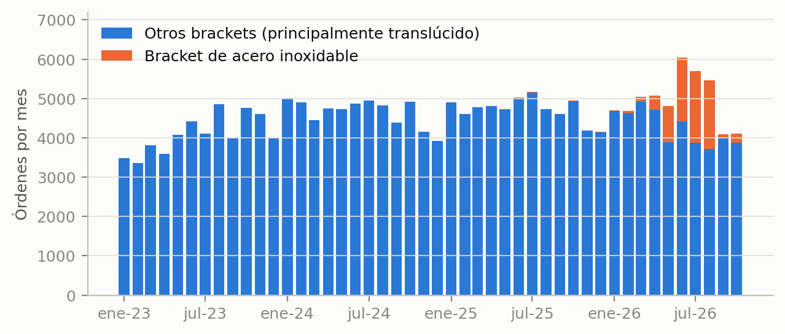
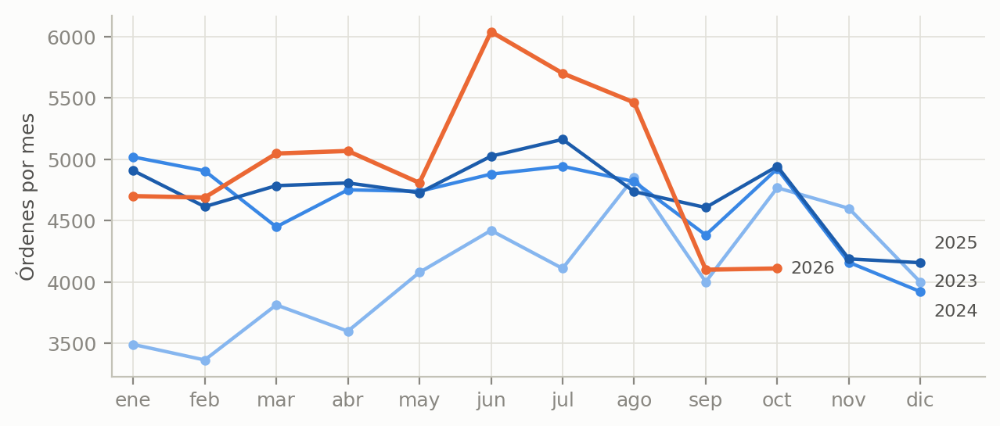
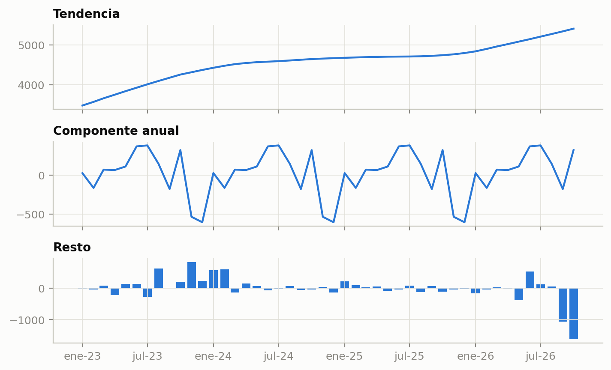
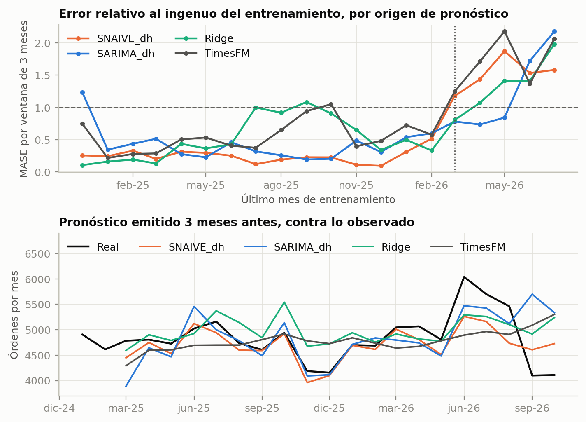
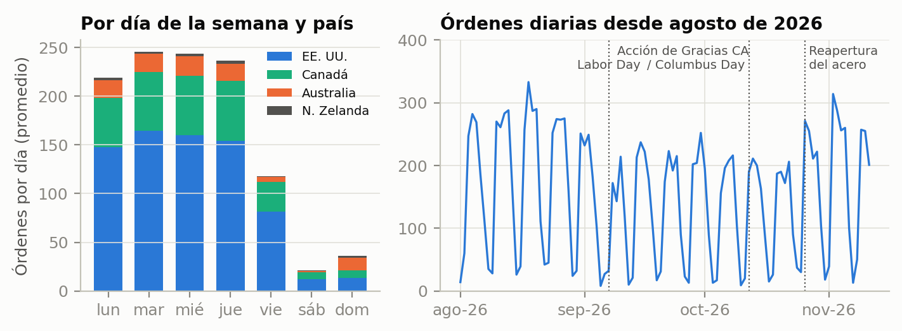

<!-- PORTADA (no cuenta en el límite de páginas) -->

**Curso:** Modelado matemático (BCD5105), III Cuatrimestre 2026

**Proyecto integrador:** Avance 1, planteamiento y primer modelo

**Título:** Pronóstico de las órdenes entrantes de LightForce Orthodontics: comparación de modelos clásicos y de fundación

**Grupo:** 2

**Integrantes:**

- Daniel Vasquez Gonzalez
- Santiago Villareal Arley
- Maria José Gonzalez Quesada
- Sharis Duarte Alvarado

**Fecha de entrega:** 29 de octubre de 2026

**Notebook (Python, lectura pública):** [GitHub](https://github.com/DannyV1992/curso_modelado/blob/main/Tareas/Proyecto_integrador/Avance_1/Notebook_Avance_Forecast_Mensual.ipynb) · [abrir en Colab](https://colab.research.google.com/github/DannyV1992/curso_modelado/blob/main/Tareas/Proyecto_integrador/Avance_1/Notebook_Avance_Forecast_Mensual.ipynb)

# 1. Introducción y planteamiento del problema

## 1.1 La empresa

La ortodoncia es la rama de la odontología que corrige la posición de los dientes. El tratamiento más común usa *brackets*: piezas pequeñas que el ortodoncista pega a cada diente y por las que pasa un alambre que, con los meses, lleva los dientes a su lugar. Normalmente los brackets salen de fábrica iguales para todos los pacientes, y el ortodoncista hace los ajustes durante el tratamiento.

LightForce Orthodontics es una empresa de EE. UU., fundada en 2019, que fabrica brackets personalizados: cada pieza se diseña por computadora para un diente concreto de un paciente y se imprime en 3D. La empresa vende solo a ortodoncistas (en adelante, "doctores") de EE. UU., Canadá, Australia y Nueva Zelanda.

Cada caso sigue el mismo camino. El doctor toma un escaneo digital de la boca del paciente, un modelo 3D de sus dientes, y lo envía a LightForce; ese envío es una **orden entrante**. Después, un equipo de técnicos de manufactura digital diseña los brackets del caso, la planta los imprime y se envían al consultorio. Tres de los cuatro supervisores de manufactura digital y sus equipos trabajan en Costa Rica. Como cada caso es distinto, el trabajo no se puede adelantar ni guardar en inventario: la carga de cada semana depende de cuántos escaneos lleguen.

## 1.2 El bracket de acero inoxidable

Hasta 2025 la empresa trabajaba casi solo con brackets cerámicos, y el volumen rondaba las 4,700 órdenes por mes. Entonces agregó a su catálogo un bracket de acero inoxidable. En 2025 hubo solo casos aislados (54 en el año), pero desde febrero de 2026 la demanda creció rápido: de 63 órdenes en febrero a 1,627 en junio y unas 1,800 en julio y agosto, cerca de un tercio de todas las órdenes del mes.

Ese crecimiento superó la capacidad de las máquinas que fabrican el acero. Por eso, a fines de agosto de 2026 la empresa dejó de aceptar casos de acero, y la recepción se reabrió el 26 de octubre; desde entonces llegan unas 47 órdenes de acero por día. El total de órdenes siguió esas decisiones: de junio a agosto promedió 5,734 por mes, 22 % más que de octubre de 2025 a abril de 2026, y en septiembre y octubre, con el acero cerrado, bajó a 4,104, 12 % menos. Al mismo tiempo, los demás brackets bajaron desde mayo, señal de que parte de los casos de acero reemplazó casos que antes habrían sido cerámicos.

Para pronosticar, esto significa que la serie de 2026 tiene saltos causados por decisiones internas de capacidad, no por cambios en la demanda de los doctores, y ningún modelo basado solo en la historia puede anticiparlos.

## 1.3 Planteamiento del problema

Los supervisores necesitan saber con anticipación cuántas órdenes van a llegar para decidir cuántas personas trabajan en cada turno, cuándo pedir horas extra, cuándo aprobar vacaciones y si hay que contratar. Como los equipos están en Costa Rica, todas las fechas se expresan en hora de Costa Rica, aunque los escaneos llegan de cuatro países con horarios y feriados propios.

Este proyecto busca estimar esa cantidad, es decir, hacer un **pronóstico**: una estimación de las órdenes futuras a partir de las pasadas. Tiene dos partes:

- **Parte 1, este avance: pronóstico mensual a tres meses.** Cuántas órdenes entrantes llegarán en cada uno de los próximos tres meses. Se comparan los modelos estadísticos clásicos vistos en el curso, que se ajustan a la historia de la empresa, con **modelos de fundación**: modelos de inteligencia artificial preentrenados con miles de series de otros ámbitos, que pronostican sin entrenarse con estos datos.
- **Parte 2, próxima entrega (sección 7): pronóstico diario a 15 días.** Cuántas órdenes llegarán cada día de las próximas dos semanas. El conteo diario varía mucho según el día de la semana y los feriados de cada país, mientras que el mensual suma esas variaciones y es más estable. La pregunta es si conviene **repartir el pronóstico mensual entre los días** según el patrón semanal y los feriados, en lugar de pronosticar cada día directamente.

# 2. Justificación

Un pronóstico de tres meses permite decidir con tiempo cuánta capacidad se necesita, y uno de 15 días, armar los turnos de las próximas dos semanas. Si la demanda supera lo previsto, los casos esperan en cola, cada uno tarda más y se incumplen los plazos de entrega comprometidos con los doctores; si queda por debajo, hay horas pagadas sin trabajo. Se benefician los supervisores y planificadores, que deciden la dotación; los técnicos, con una carga más estable; y los doctores, que reciben antes su plan de tratamiento. Además, conviene saber si los modelos de fundación, que no requieren entrenamiento, superan a reglas simples con una serie corta.

# 3. Objetivos

**Objetivo general.** Identificar el modelo que mejor pronostica las órdenes entrantes de LightForce Orthodontics a dos escalas, mensual a tres meses y diaria a 15 días, comparando modelos clásicos y de fundación con una validación común, y determinar si repartir el pronóstico mensual entre los días supera a modelar directamente la serie diaria.

**Objetivos específicos de la parte 1, pronóstico mensual (este avance).**

1. Construir la serie diaria y mensual de órdenes entrantes en hora de Costa Rica, total y por país (enero de 2023 a octubre de 2026), documentar su definición e incluirla en el repositorio para que el análisis sea reproducible.
2. Caracterizar la tendencia, la estacionalidad anual, el efecto de los días hábiles y el del bracket de acero mediante estadísticas descriptivas, autocorrelación y descomposición STL.
3. Comparar 12 modelos (ingenuos, ETS, SARIMA, sus versiones por día hábil, Ridge, Prophet, Chronos-2 y TimesFM) con validación de ventana expansiva de 20 orígenes, mediante MAE, RMSE, MASE y la prueba de Wilcoxon contra el ingenuo estacional.
4. Emitir el pronóstico de noviembre de 2026 a enero de 2027 con el mejor modelo e intervalos empíricos.

**Objetivos específicos de la parte 2, pronóstico diario (próxima entrega).**

5. Estimar el patrón diario de cada país: el perfil por día de la semana y el efecto de sus feriados locales, llevados a la fecha de Costa Rica.
6. Repartir el pronóstico mensual del mejor modelo entre los días del mes según ese patrón, también cuando el pronóstico se emite a mitad de mes.
7. Comparar modelos diarios directos (SNAIVE semanal, ETS, SARIMA, MSTL, Prophet, Chronos-2, TimesFM y LightGBM) y un híbrido con el reparto, a 15 días y con validación de ventana expansiva semanal.
8. Contrastar la hipótesis con el MASE diario, el error del total de 15 días y el error en feriados, mediante la prueba de Wilcoxon pareada, y emitir el pronóstico diario de los 15 días siguientes.

# 4. Dataset y análisis exploratorio

**Fuente.** Base de datos analítica de LightForce Orthodontics (Databricks), tabla `analytics.manufacturing.mfg_all_orders`, consultada el 12 de noviembre de 2026 con autorización de la empresa. Como la base es interna, el resultado de la consulta (conteos por día, sin casos individuales) se guarda en el repositorio (`datos/ordenes_diarias.csv`, 1,411 días) junto con la consulta SQL.

**Definición y período.** Una orden entrante es un caso nuevo (`order_type = 'New case'`) con fecha de recepción del escaneo (`scan_received_date`). Se cuentan todos los estados, incluso casos luego cancelados. La fecha viene en UTC y se pasa a hora de Costa Rica (UTC−6), donde se atienden los casos; a escala mensual el cambio es pequeño (17 órdenes por mes en promedio). La serie mensual va de enero de 2023 a octubre de 2026 (46 meses, 211,325 órdenes); se excluyen 2019 a 2022, años de rampa, y noviembre de 2026, incompleto (2,033 órdenes al día 11).

| Variable | Tipo y unidad | Descripción |
|----------------------|--------------------------------|----------------------------------------------|
| `fecha` | Fecha (día, hora de Costa Rica) | Día en que se recibió el escaneo |
| `ordenes` | Entero ≥ 0, órdenes | Casos nuevos con escaneo recibido (a pronosticar) |
| `acero` | Entero ≥ 0, órdenes | De ellas, con bracket de acero inoxidable |
| `us`, `ca`, `au`, `nz` | Entero ≥ 0, órdenes | Por país de la cuenta (Puerto Rico en EE. UU.) |
| `dias_habiles` | Entero, días (derivada) | Lunes a viernes del mes, entre 20 y 23 |

Tabla 1. Variables del conjunto de datos.

**Estadísticas descriptivas.** La media mensual es 4,594 órdenes (mediana 4,731; desviación 544; coeficiente de variación 0.12), con mínimo de 3,363 (febrero de 2023) y máximo de 6,039 (junio de 2026). Los totales anuales son 49,084 (2023), 55,879 (2024), 56,647 (2025) y 49,715 de enero a octubre de 2026 (4,972 por mes). Por país, EE. UU. aporta entre 65 % y 70 %, Canadá entre 22 % y 25 %, Australia entre 7 % y 9 % y Nueva Zelanda entre 1 % y 2 %.

{width=58%}

**Figura 1.** El volumen se estabiliza en 2024 y 2025 entre 3,920 y 5,161 órdenes por mes. En 2026 se ven el auge y la pausa del acero descritos en la sección 1: llega al 27 % del mes en junio y al 32 % en julio y agosto, y cae a 118 órdenes en septiembre. **Implicación:** el acero se trata como un cambio de nivel externo; no se modela y la validación se separa en marzo de 2026 para medir su efecto.

{width=58%}

**Figura 2.** Los trazos de 2024 y 2025 son casi iguales: los meses más bajos son noviembre (índice 0.89 respecto del promedio de su año) y diciembre (0.86), y los más altos enero y junio (1.06), julio (1.08) y octubre (1.05). **Implicación:** el patrón anual es repetible y de amplitud moderada (±10 %), así que repetir el mes del año anterior será una referencia difícil de superar. Parte de esas diferencias se debe a los días hábiles (20 a 23, ±7 %), lo que motiva el ajuste por día hábil.

{width=58%}

**Figura 3.** La fuerza de la tendencia es 0.38 y la de la estacionalidad anual 0.28 (de 0 a 1), debilitadas por los restos de septiembre (−1,058) y octubre de 2026 (−1,614), efecto de la pausa del acero. La autocorrelación es 0.51 en el rezago 1 y 0.15 en el 12. **Implicación:** con menos de cuatro ciclos la estacionalidad se estima con poca precisión. ADF y KPSS no coinciden sobre la serie original (p = 0.002 y 0.02) y sí tras $(1-B)(1-B^{12})$ (p < 0.001 y ≥ 0.10).

# 5. Formulación matemática inicial

**Variables.** Sea $y_t \in \mathbb{N}$ el número de órdenes del mes $t$, con $t = 1, \dots, T$ y $T = 46$, y $d_t$ sus días hábiles (lunes a viernes). Se busca $\hat y_{T+h \mid T}$ para $h = 1, 2, 3$. El período estacional es $m = 12$ y $B$ es el operador de rezago.

**Modelos comparados.**

- *Referencias.* Ingenuo: $\hat y_{T+h} = y_T$. Ingenuo estacional (SNAIVE): $\hat y_{T+h} = y_{T+h-12}$.
- *ETS y SARIMA.* AutoETS elige error, tendencia y estacionalidad por AICc. El SARIMA$(p,d,q)(P,D,Q)_{12}$ cumple
$$\phi(B)\,\Phi(B^{12})\,(1-B)^d(1-B^{12})^D\, y_t = c + \theta(B)\,\Theta(B^{12})\,\varepsilon_t,$$
con órdenes elegidos por AutoARIMA (pruebas de raíz unitaria y AICc) y coeficientes por máxima verosimilitud.
- *Ajuste por días hábiles* (sufijo `_dh`). Se modela la tasa $r_t = y_t / d_t$ con el mismo método y se vuelve a órdenes con $\hat y_{T+h} = d_{T+h}\,\hat r_{T+h}$. Para SNAIVE_dh, $\hat y_{T+h} = d_{T+h}\; y_{T+h-12} / d_{T+h-12}$.
- *Ridge.* $y_t = \beta_0 + \beta_1 t + \sum_{j=2}^{12} \gamma_j\, \mathbb{1}[\text{mes}(t)=j] + \delta\, d_t + \varepsilon_t$, con coeficientes que minimizan $\sum_t (y_t - \hat y_t)^2 + \lambda \lVert \beta \rVert^2$ (Hoerl y Kennard, 1970) y $\lambda$ elegido por validación temporal.
- *Prophet.* $y_t = g(t) + s(t) + \varepsilon_t$: tendencia lineal por tramos y estacionalidad anual de Fourier (Taylor y Letham, 2018).
- *Fundación.* $\hat y_{T+h}$ es la mediana de $f_\theta(y_1,\dots,y_T)$, con $\theta$ preentrenado en miles de series y sin ajuste a estos datos: Chronos-2 (Ansari et al., 2025), también con $d_t$ como covariable conocida, y TimesFM 2.5 (Das et al., 2024).

**Restricciones.** (i) $y_t \ge 0$: todo pronóstico se trunca en cero, $\hat y^{+}_{t} = \max(0, \hat y_t)$. (ii) En SARIMA, estacionariedad e invertibilidad: las raíces de los polinomios quedan fuera del círculo unitario. (iii) Validación sin fuga: cada pronóstico usa solo datos anteriores a su origen, y cada modelo se vuelve a ajustar (y el SARIMA a identificar) en cada ventana.

**Supuestos y su justificación.**

- *Período anual fijo ($m = 12$):* el índice de 2024 y 2025 es casi idéntico (Figura 2), aunque la fuerza estacional es 0.28.
- *Proporcionalidad a los días hábiles:* las órdenes llegan casi solo de lunes a viernes (236 por día de lunes a jueves, 28 en fin de semana).
- *Innovaciones no correlacionadas:* se verifica con Ljung-Box sobre los residuos del SARIMA.
- *Sin cambio estructural:* el acero no se modela; su efecto se evalúa aparte.

**Métricas de éxito.** Con $e_t = y_t - \hat y^{+}_t$ y $n$ pronósticos,

$$\text{MAE} = \frac{1}{n}\sum |e_t|, \qquad \text{RMSE} = \sqrt{\frac{1}{n}\sum e_t^2}, \qquad \text{MASE} = \frac{\text{MAE}}{\frac{1}{n_0 - 12}\sum_{t=13}^{n_0} |y_t - y_{t-12}|},$$

donde el denominador es el error del ingenuo estacional en el entrenamiento ($n_0$ meses); un MASE menor que 1 supera a ese ingenuo (Hyndman y Koehler, 2006). Se calcula por ventana y se promedia; también se reporta el sesgo medio $\frac{1}{n}\sum(\hat y_t - y_t)$.

**Validación.** Ventana expansiva: el primer entrenamiento va de enero de 2023 a diciembre de 2024 y pronostica tres meses; se agrega un mes por ventana hasta pronosticar agosto a octubre de 2026 (20 ventanas, 60 pronósticos por modelo). **Criterio de éxito:** MASE menor que 1 y menor que el de SNAIVE en la mayoría de las ventanas, confirmado con la prueba de Wilcoxon pareada (Wilcoxon, 1945). Por el acero, los resultados se separan según el origen: antes de marzo de 2026 (15 ventanas) y desde marzo (5 ventanas).

# 6. Primer modelo aplicado y comparación

Los 12 modelos se evaluaron en el notebook (Python 3.12, `statsforecast` 2.1.1, `prophet` 1.5.0, `chronos-forecasting` 2.3.2, `timesfm` 3.0.2, semilla 2026). La referencia ingenua es SNAIVE.

| Modelo | MAE | MASE | MASE antes | MASE desde | Gana | p | Sesgo |
|-----------------|--------|-------|--------|--------|------|--------|-------|
| **SNAIVE_dh** | **234.6** | **0.56** | **0.25** | 1.52 | 14 | 0.008 | −163 |
| SARIMA_dh | 283.5 | 0.63 | 0.43 | **1.25** | 8 | 0.55 | −49 |
| SNAIVE (ref.) | 268.7 | 0.65 | 0.33 | 1.61 | – | – | −154 |
| SARIMA | 306.8 | 0.70 | 0.39 | 1.62 | 10 | 0.76 | −48 |
| Ridge | 301.1 | 0.71 | 0.50 | 1.34 | 10 | 0.70 | +74 |
| Prophet | 337.5 | 0.76 | 0.52 | 1.48 | 4 | 0.040 | −112 |
| AutoETS_dh | 352.0 | 0.81 | 0.58 | 1.49 | 4 | 0.014 | −88 |
| TimesFM 2.5 | 357.4 | 0.84 | 0.54 | 1.71 | 3 | 0.001 | −86 |
| Chronos-2_dh | 393.0 | 0.91 | 0.60 | 1.83 | 2 | < 0.001 | −150 |
| AutoETS | 374.8 | 0.91 | 0.48 | 2.19 | 4 | 0.002 | −112 |
| Chronos-2 | 403.7 | 0.92 | 0.67 | 1.67 | 2 | < 0.001 | −90 |
| Ingenuo | 465.8 | 1.09 | 0.74 | 2.14 | 2 | < 0.001 | −42 |

Tabla 2. Validación a 3 meses (20 ventanas, 60 pronósticos por modelo). MASE antes y desde: ventanas con origen antes de marzo de 2026 (15) y desde marzo (5). Gana: ventanas con MASE menor que SNAIVE. p: Wilcoxon contra SNAIVE. MAE y sesgo en órdenes por mes.

**Lectura de los resultados.**

- *El mejor modelo es SNAIVE_dh,* el único que cumple todo el criterio: MASE de 0.56, menor que el de SNAIVE en 14 de 20 ventanas (p = 0.008). A SARIMA_dh, el segundo, le gana en 13 de 20 (p = 0.14, no significativo). El error crece con el horizonte (MASE 0.51, 0.56 y 0.63 a uno, dos y tres meses).
- *El ajuste por días hábiles mejora a los tres clásicos* (SNAIVE de 0.65 a 0.56, SARIMA de 0.70 a 0.63, AutoETS de 0.91 a 0.81) y casi no cambia a Chronos-2.
- *Los modelos de fundación no superan a las referencias:* TimesFM (0.84) y Chronos-2 (0.92) superan al ingenuo, pero a SNAIVE solo en 2 o 3 ventanas. Con 24 a 43 meses de contexto suavizan el patrón anual, que aquí es lo más predecible.
- *Desde marzo de 2026 todos fallan* (MASE entre 1.25 y 2.19). SARIMA_dh y Ridge siguen mejor el nivel reciente, pero a tres meses pronosticaron entre 4,900 y 5,700 órdenes para septiembre y octubre, contra unas 4,100 observadas (Figura 4).
- *El orden de SARIMA_dh es inestable:* $(0,1,0)(0,1,0)_{12}$ en 11 ventanas, $(0,1,0)(1,1,0)_{12}$ en 5 y otros tres en las 4 restantes. Con los 46 meses queda $(1-B)(1-B^{12})\,r_t = \varepsilon_t$; sus residuos son compatibles con ruido blanco (Ljung-Box p = 0.40 con 6 rezagos y 0.68 con 12; $n = 33$).
- *Casi todos subestiman,* porque el nivel creció; en SNAIVE_dh el sesgo es de −163 órdenes por mes.

{width=58%}

| Mes (días hábiles) | SNAIVE_dh (80 %) | SARIMA_dh | Ridge | TimesFM |
|------------------|------------------------|-----------|---------|----------|
| Nov. 2026 (21) | 4,396 (4,338 a 4,874) | 3,806 | 4,726 | 4,179 |
| Dic. 2026 (23) | 4,156 (4,101 a 4,608) | 3,510 | 4,660 | 4,203 |
| Ene. 2027 (21) | 4,485 (4,359 a 4,973) | 3,895 | 4,883 | 4,382 |
| **Total** | **13,038** | **11,211** | **14,269** | **12,764** |

Tabla 3. Pronóstico de noviembre de 2026 a enero de 2027 con los 46 meses. El intervalo es empírico: cuantiles 10 y 90 del cociente real/pronóstico de la validación en cada horizonte; es asimétrico hacia arriba por el sesgo negativo.

**Pronóstico adoptado: SNAIVE_dh.** Del 1 al 11 de noviembre de 2026 llegaron 2,033 órdenes, 8 % más por día hábil que en 2025, lo que proyecta cerca de 4,750 en noviembre: dentro del intervalo y coherente con la reapertura del acero. SARIMA_dh arrastra el nivel bajo de septiembre y octubre y pronostica un trimestre 14 % menor. Con 46 meses gana la regla más simple corregida por calendario; ningún modelo anticipa cambios de nivel causados por decisiones de capacidad.

# 7. Próximos pasos: pronóstico diario a 15 días

**Pregunta.** La serie diaria es mucho más variable que la mensual: de lunes a jueves llegan unas 236 órdenes por día, el viernes 118 y el fin de semana 28, y los feriados la alteran. La hipótesis es que **repartir el pronóstico mensual entre los días según esos patrones da un pronóstico a 15 días más preciso que modelar la serie diaria directamente.**

{width=58%}

**Hora local y feriados por país (Figura 5).** El pronóstico se emite en hora de Costa Rica, pero los feriados ocurren en la fecha local de cada cliente. En EE. UU. y Canadá los escaneos llegan entre las 6:00 y las 16:00 de Costa Rica, y la fecha coincide. En Australia y Nueva Zelanda la jornada cae en la tarde del día anterior de Costa Rica: su lunes llega el domingo y un feriado suyo reduce el día anterior en Costa Rica. Por eso se trabaja **por país**, $y_{p,t}$ con $p \in \{\text{US}, \text{CA}, \text{AU}, \text{NZ}\}$, con su calendario local en fecha de Costa Rica.

**Métodos a comparar.**

- *A. Reparto del pronóstico mensual.* Para cada día $t$ se calcula un nivel esperado $n_t = \sum_p s_p(w_t)\, f_p(t)$, donde $s_p(w)$ es el promedio del país $p$ en el día de la semana $w$ (últimas 26 semanas sin feriados) y $f_p(t)$ el factor del feriado (mediana del cociente real/base en sus ocurrencias pasadas; 1 si no hay feriado). El pronóstico diario es $\hat y_t = \hat Y_{M(t)}\, n_t / \sum_{s \in M(t)} n_s$, con $\hat Y_M$ el pronóstico SNAIVE_dh del mes. Variante A2: cuando el origen cae a mitad de mes, se reparte solo lo que falta, $\max(0, \hat Y_M - \text{observado})$, entre los días restantes.
- *B. Modelos diarios directos* con $m = 7$: SNAIVE semanal, ETS, SARIMA, MSTL (períodos 7 y 365), Prophet con feriados por país, Chronos-2 con feriados como covariables, TimesFM y LightGBM con rezagos y calendario.
- *C. Híbrido:* combinar A con el mejor de B.

**Validación.** Unos 52 orígenes semanales del último año a 15 días, sin fuga y con las métricas del objetivo 8. Riesgos: el fin de año y el nivel del acero tras la reapertura.

# Referencias

Ansari, A. F., Shchur, O., Küken, J., Auer, A., Han, B., Mercado, P., Rangapuram, S. S., Shen, H., Stella, L., Zhang, X., Goswami, M., Kapoor, S., Maddix, D. C., Guerron, P., Hu, T., Yin, J., Erickson, N., Desai, P. M., Wang, H., … Bohlke-Schneider, M. (2025). *Chronos-2: From univariate to universal forecasting* (arXiv:2510.15821). arXiv. https://arxiv.org/abs/2510.15821

Cleveland, R. B., Cleveland, W. S., McRae, J. E., & Terpenning, I. (1990). STL: A seasonal-trend decomposition procedure based on loess. *Journal of Official Statistics, 6*(1), 3–73.

Das, A., Kong, W., Sen, R., & Zhou, Y. (2024). A decoder-only foundation model for time-series forecasting. En *Proceedings of the 41st International Conference on Machine Learning*. https://arxiv.org/abs/2310.10688

Dickey, D. A., & Fuller, W. A. (1979). Distribution of the estimators for autoregressive time series with a unit root. *Journal of the American Statistical Association, 74*(366), 427–431. https://doi.org/10.1080/01621459.1979.10482531

Garza, A., Mergenthaler-Canseco, M., Challú, C., & Olivares, K. G. (2022). *StatsForecast: Lightning fast forecasting with statistical and econometric models*. PyCon Salt Lake City. https://github.com/Nixtla/statsforecast

Hoerl, A. E., & Kennard, R. W. (1970). Ridge regression: Biased estimation for nonorthogonal problems. *Technometrics, 12*(1), 55–67. https://doi.org/10.1080/00401706.1970.10488634

Hyndman, R. J., & Athanasopoulos, G. (2021). *Forecasting: Principles and practice* (3.ª ed.). OTexts. https://otexts.com/fpp3/

Hyndman, R. J., & Khandakar, Y. (2008). Automatic time series forecasting: The forecast package for R. *Journal of Statistical Software, 27*(3), 1–22. https://doi.org/10.18637/jss.v027.i03

Hyndman, R. J., & Koehler, A. B. (2006). Another look at measures of forecast accuracy. *International Journal of Forecasting, 22*(4), 679–688. https://doi.org/10.1016/j.ijforecast.2006.03.001

Kwiatkowski, D., Phillips, P. C. B., Schmidt, P., & Shin, Y. (1992). Testing the null hypothesis of stationarity against the alternative of a unit root. *Journal of Econometrics, 54*(1–3), 159–178. https://doi.org/10.1016/0304-4076(92)90104-Y

LightForce Orthodontics. (2026). *Tabla analytics.manufacturing.mfg_all_orders* [Base de datos interna de manufactura, Databricks]. Datos consultados el 12 de noviembre de 2026.

Ljung, G. M., & Box, G. E. P. (1978). On a measure of lack of fit in time series models. *Biometrika, 65*(2), 297–303. https://doi.org/10.1093/biomet/65.2.297

Seabold, S., & Perktold, J. (2010). statsmodels: Econometric and statistical modeling with Python. *Proceedings of the 9th Python in Science Conference*, 92–96. https://doi.org/10.25080/Majora-92bf1922-011

Taylor, S. J., & Letham, B. (2018). Forecasting at scale. *The American Statistician, 72*(1), 37–45. https://doi.org/10.1080/00031305.2017.1380080

Wilcoxon, F. (1945). Individual comparisons by ranking methods. *Biometrics Bulletin, 1*(6), 80–83. https://doi.org/10.2307/3001968
