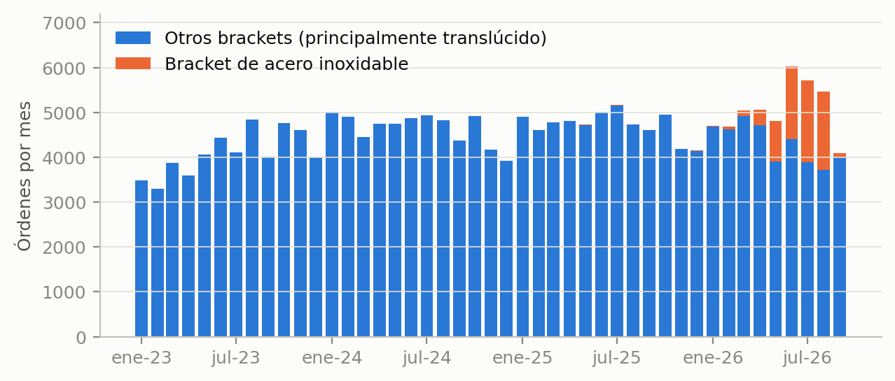
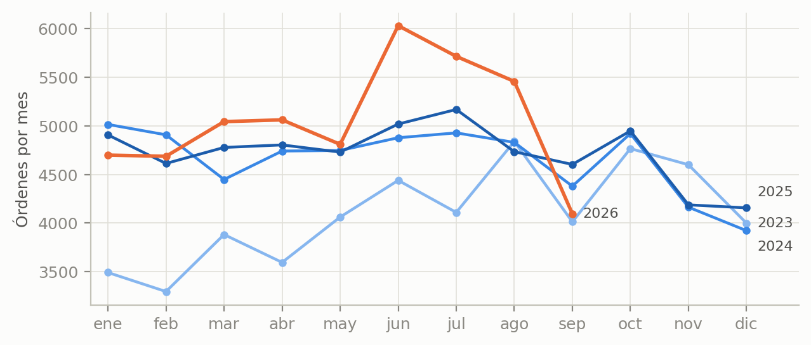
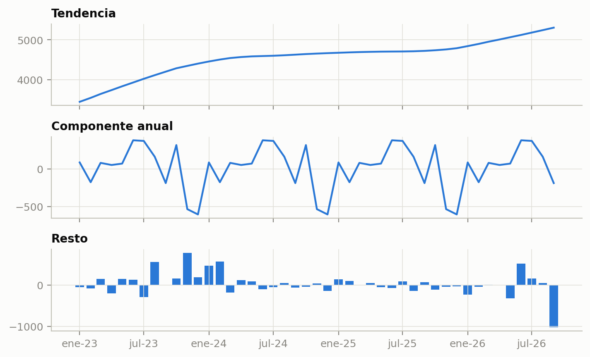
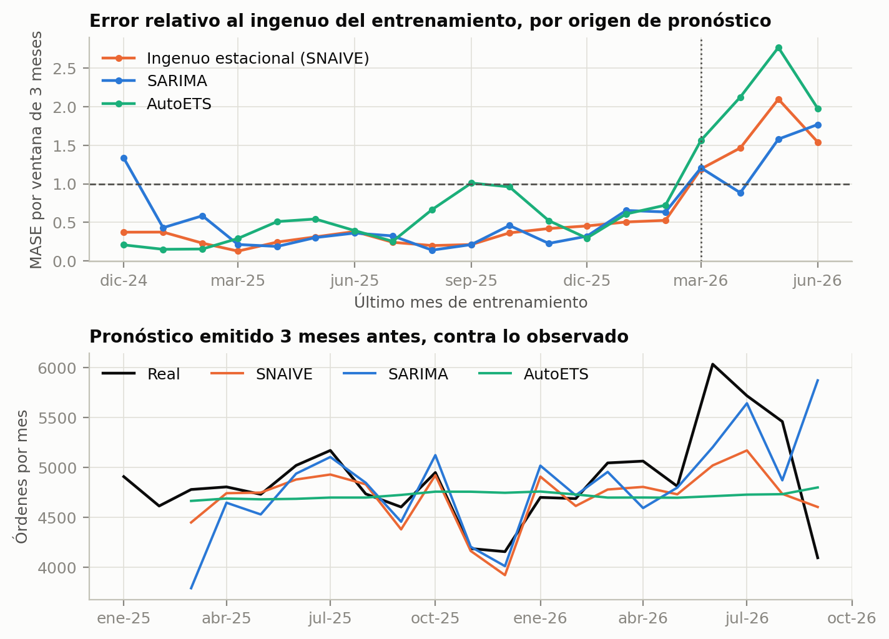

<!-- PORTADA (no cuenta en el límite de páginas) -->

**Curso:** Modelado matemático (BCD5105), III Cuatrimestre 2026

**Proyecto integrador:** Avance 1, planteamiento y primer modelo

**Título:** Pronóstico mensual de las órdenes entrantes de LightForce Orthodontics mediante series temporales

**Integrantes:**

- Daniel Vasquez Gonzalez
- Santiago Villareal Arley
- Maria José Gonzalez Quesada
- Sharis Duarte Alvarado

**Fecha de entrega:** 29 de octubre de 2026

**Notebook (Python, lectura pública):** [GitHub](https://github.com/DannyV1992/curso_modelado/blob/main/Tareas/Proyecto_integrador/Avance_1/Notebook_Avance_Forecast_Mensual.ipynb) · [abrir en Colab](https://colab.research.google.com/github/DannyV1992/curso_modelado/blob/main/Tareas/Proyecto_integrador/Avance_1/Notebook_Avance_Forecast_Mensual.ipynb)

# 1. Introducción y planteamiento del problema

LightForce Orthodontics es una empresa de EE. UU. (fundada en 2019) que fabrica aparatos ortodónticos totalmente personalizados con impresión 3D y CAD/CAM, y que vende solo a ortodoncistas. Cada pedido nace cuando el doctor envía el escaneo digital de la dentadura del paciente; el caso se registra en el sistema de manufactura y pasa por distintas etapas de diseño digital hasta la manufactura fisica y envío. Como cada caso es único, el trabajo no se puede inventariar: la carga de manufactura depende de cuántos escaneos llegan.

El problema que se aborda es **pronosticar cuántas órdenes entrantes (escaneos recibidos) llegarán cada mes durante los próximos tres meses**. Una orden entrante es un caso nuevo con escaneo recibido. El volumen mensual ronda las 4,700 órdenes desde 2024, pero en 2026 se movió entre 4,095 y 6,032 por el lanzamiento de un producto nuevo, el bracket de acero inoxidable: se habilitó de forma progresiva, la demanda superó la capacidad de las máquinas y se detuvo su recepción para ajustar la capacidad durante el último trimestre.

El contexto costarricense es directo. Tres de los cuatro supervisores de manufactura digital trabajan en Costa Rica y desde aquí se atiende a los clientes de EE. UU. y Canadá. La demanda la determinan los doctores del norte, pero la capacidad la aportan los equipos en Costa Rica, de modo que anticipar el volumen mensual es una entrada directa para planificar turnos, horas extra, vacaciones, contrataciones, etc. A mediano plazo el objetivo es un pronóstico diario; este avance parte de la escala mensual, más simple y apropiada para construir un primer modelo con los métodos del curso.

# 2. Justificación

Un pronóstico de tres meses ayuda a decidir con tiempo cuánta capacidad se necesita. Si la demanda supera lo previsto, los casos esperan en cola y se alargan los tiempos de ciclo y SLAs que la empresa monitorea; si queda por debajo, hay horas pagadas sin trabajo. Además, las cuentas de cada doctor están asignadas a un equipo específico, por lo que un exceso de casos no se reparte automáticamente entre equipos y conviene anticiparlo.

Se benefician los supervisores y planificadores de manufactura digital, que toman las decisiones de dotación; los técnicos en Costa Rica, cuya carga de trabajo sería más estable; y los doctores, que reciben antes su plan de tratamiento. El impacto económico no se cuantifica en este avance; lo que se mide es cuánto mejora el pronóstico respecto de una regla simple y cuándo falla.

# 3. Objetivos

**Objetivo general.** Modelar y pronosticar el número mensual de órdenes entrantes de LightForce Orthodontics entre enero de 2023 y septiembre de 2026 con un modelo SARIMA, y evaluar si supera de forma consistente al pronóstico ingenuo estacional, para apoyar la planificación de capacidad con un horizonte de tres meses.

**Objetivos específicos.**

1. Construir la serie mensual de órdenes entrantes (45 meses) a partir de la tabla de órdenes de manufactura y documentar su definición.
2. Caracterizar la tendencia, la estacionalidad anual y el efecto del lanzamiento del bracket de acero inoxidable mediante estadísticas descriptivas, autocorrelación y descomposición STL.
3. Ajustar un SARIMA con período 12 y compararlo con el ingenuo estacional y AutoETS mediante MAE, RMSE y MASE, con validación de ventana expansiva (19 ventanas de tres meses).
4. Diagnosticar los residuos e identificar las limitaciones del modelo, para definir el segundo método de la entrega final.

# 4. Dataset y análisis exploratorio

**Fuente.** Base de datos analítica de LightForce Orthodontics (Databricks), tabla `analytics.manufacturing.mfg_all_orders`, consultada el 26 de octubre de 2026 con autorización de la empresa. Es una fuente interna, sin enlace público; la consulta SQL y la serie resultante (45 filas) están en el notebook. Cada fila de la tabla es un caso de manufactura.

**Definición y período.** Una orden entrante es un caso nuevo (`order_type = 'New case'`) con fecha de recepción del escaneo (`scan_received_date`), pasada de UTC a hora del este de EE. UU. antes de asignar el mes. Se cuentan todos los estados, incluso casos luego cancelados, porque la demanda llegó. El período es enero de 2023 a septiembre de 2026 (45 meses, 207,214 órdenes). Se excluyen 2019 a 2022, años de rampa de crecimiento (66 casos en 2019 y 29,139 en 2022; desde 2023 el volumen anual está entre 49,000 y 57,000). Octubre de 2026 solo tiene datos hasta el día 25 (3,036 órdenes), por lo que no se usa en el ajuste.

| Variable | Tipo | Unidad | Descripción |
|---|---|---|---|
| `mes` | Fecha (índice) | Mes calendario, hora ET | Mes en que se recibió el escaneo |
| `ordenes` | Entero, no negativo | Órdenes por mes | Casos nuevos con escaneo recibido (variable a pronosticar) |
| `acero` | Entero, no negativo | Órdenes por mes | De ellas, las de bracket de acero inoxidable (`bracket_material_name`) |
| `dias_habiles` | Entero (derivada) | Días, lunes a viernes | Días hábiles del mes, entre 20 y 23 |

Tabla 1. Variables del conjunto de datos.

**Estadísticas descriptivas.** La media mensual es 4,605 órdenes (mediana 4,734; desviación 547; coeficiente de variación 0.12), con mínimo de 3,294 (febrero de 2023) y máximo de 6,032 (junio de 2026). Los totales anuales son 49,084 (2023; 4,090 por mes), 55,879 (2024; 4,657), 56,648 (2025; 4,721) y 45,603 de enero a septiembre de 2026 (5,067 por mes).

{width=82%}

**Figura 1.** Tras crecer durante 2023, el volumen se estabiliza desde 2024 entre 3,900 y 5,200 órdenes por mes. En 2026 aparece el bracket de acero: 63 órdenes en febrero, 352 en abril, 1,625 en junio (27 % del mes) y 1,829 en julio (32 %); luego cae a 117 en septiembre (3 %). El total de junio a agosto promedia 5,735, un 22 % sobre el promedio de octubre de 2025 a abril de 2026 (4,683), y septiembre (4,095) queda 13 % debajo. Las órdenes del resto de brackets oscilan entre 3,721 y 4,407 de mayo a septiembre de 2026, bajo el rango de 4,145 a 5,158 de los diez meses previos, lo que sugiere que parte del acero sustituyó a otros productos (hipótesis que no se prueba aquí). **Implicación:** el auge y la caída de 2026 son una decisión de capacidad, no una variación natural de la demanda, y los modelos deben evaluarse por separado en ese tramo. La serie no se recorta ni se ajusta: son órdenes realmente recibidas.

{width=82%}

**Figura 2.** Los trazos de 2024 y 2025 son casi iguales: los meses más bajos son noviembre (índice 0.89 respecto del promedio de su año) y diciembre (0.86), y los más altos enero, junio, julio y octubre (1.05 a 1.08). 2023 queda más abajo por el crecimiento, y 2026 se separa a partir de mayo. **Implicación:** hay un patrón anual repetible pero de amplitud moderada (cerca de ±10 %), por lo que repetir el mismo mes del año anterior será una referencia difícil de superar.

{width=82%}

**Figura 3.** La fuerza de la tendencia es 0.65 y la de la estacionalidad anual 0.51 (escala de 0 a 1), es decir, moderadas. La tendencia sube en 2023, se aplana en torno a 4,700 y vuelve a subir en 2026. El resto más grande es septiembre de 2026 (−1,021 órdenes), la caída del acero. La autocorrelación es 0.50 en el rezago 1, 0.35 en el 2 y solo 0.16 en el 12. **Implicación:** la dependencia entre meses vecinos es más clara que la estacional, y con solo 45 meses (menos de cuatro ciclos) la estacionalidad se estima con poca precisión. Las pruebas de raíz unitaria no coinciden sobre la serie original (ADF p = 0.002; KPSS p = 0.02), pero sí tras la diferencia estacional (ADF p = 0.006; KPSS p ≥ 0.10).

# 5. Formulación matemática inicial

**Variables.** Sea $y_t \in \mathbb{N}$ el número de órdenes entrantes del mes $t$, con $t = 1, \dots, T$ y $T = 45$. Se busca el pronóstico $\hat y_{T+h \mid T}$ para $h = 1, 2, 3$. El período estacional es $m = 12$ y $B$ es el operador de rezago ($B y_t = y_{t-1}$).

**Modelo.** Un SARIMA$(p,d,q)(P,D,Q)_m$ cumple

$$\phi(B)\,\Phi(B^m)\,(1-B)^d(1-B^m)^D\, y_t = c + \theta(B)\,\Theta(B^m)\,\varepsilon_t, \qquad \varepsilon_t \sim (0, \sigma^2),$$

donde $\phi$, $\theta$, $\Phi$ y $\Theta$ son polinomios de grados $p$, $q$, $P$ y $Q$. Los órdenes se identifican con AutoARIMA (pruebas de raíz unitaria para $d$ y $D$, y criterio AICc para el resto) y los coeficientes se estiman por máxima verosimilitud. Con los 45 meses se obtiene SARIMA$(1,1,0)(0,1,0)_{12}$, es decir,

$$(1-\phi_1 B)(1-B)(1-B^{12})\,y_t = \varepsilon_t.$$

En palabras: el cambio de un mes al siguiente, medido contra el mismo cambio un año antes, depende del cambio del mes anterior.

**Restricciones.** (i) $y_t \ge 0$: todo pronóstico se trunca en cero, $\hat y^{+}_{t} = \max(0, \hat y_t)$. (ii) Estacionariedad e invertibilidad: las raíces de los polinomios quedan fuera del círculo unitario. (iii) Validación sin fuga: cada pronóstico usa solo datos anteriores a su origen, y el orden se vuelve a identificar en cada ventana.

**Supuestos y su justificación.**

- *Período anual fijo ($m = 12$).* Está respaldado solo en parte: la fuerza estacional es 0.51 y el índice de 2024 y 2025 es casi idéntico (Figura 2), pero la ACF en el rezago 12 es 0.16.
- *Estacionariedad tras diferenciar.* ADF y KPSS coinciden en que $(1-B^{12})y_t$ es estacionaria (sección 4).
- *Innovaciones no correlacionadas y aproximadamente normales.* Se verifica con Ljung-Box. Es razonable porque los conteos mensuales son de miles.
- *Calendario sin ajustar.* Los meses tienen entre 20 y 23 días hábiles (alrededor de ±7 %); el modelo principal no lo corrige y se prueba como sensibilidad.
- *Sin cambio estructural.* El lanzamiento y la pausa del acero no se modelan; su efecto se evalúa aparte.

**Métricas de éxito.** Con $e_t = y_t - \hat y^{+}_t$ y $n$ pronósticos,

$$\text{MAE} = \frac{1}{n}\sum |e_t|, \qquad \text{RMSE} = \sqrt{\frac{1}{n}\sum e_t^2}, \qquad \text{MASE} = \frac{\text{MAE}}{\frac{1}{n_0 - 12}\sum_{t=13}^{n_0} |y_t - y_{t-12}|},$$

donde el denominador es el error del ingenuo estacional dentro del entrenamiento ($n_0$ meses). Un MASE menor que 1 indica que el modelo supera al ingenuo del entrenamiento (Hyndman y Koehler, 2006). Se calcula por ventana y se promedia.

**Validación.** Ventana expansiva sin barajar: el primer entrenamiento va de enero de 2023 a diciembre de 2024 (24 meses) y pronostica tres meses; se agrega un mes por ventana hasta pronosticar julio a septiembre de 2026. Resultan 19 ventanas y 57 pronósticos. Las referencias son el **ingenuo estacional** (SNAIVE: repite el mismo mes del año anterior) y **AutoETS**. **Criterio de éxito:** MASE menor que 1 y menor que el de SNAIVE en la mayoría de las ventanas, confirmado con la prueba de Wilcoxon sobre los MASE pareados. Como el lanzamiento del acero afecta las ventanas recientes, los resultados se reportan por separado según el origen: antes de marzo de 2026 (15 ventanas, pronostican hasta mayo) y desde marzo de 2026 (4 ventanas, pronostican de abril a septiembre).

# 6. Primer modelo aplicado

El SARIMA se ajustó y evaluó en el notebook (Python 3, `statsforecast` 2.1.1, `statsmodels` 0.14.6, semilla 2026). A lo largo de las 19 ventanas, AutoARIMA eligió SARIMA$(1,1,0)(0,1,0)_{12}$ en 10, $(3,1,0)(0,1,0)_{12}$ en 7 y otros dos órdenes en las 2 restantes.

| Modelo | MAE | RMSE | MASE, todas (19) | MASE, antes de mar-2026 (15) | MASE, desde mar-2026 (4) |
|---|---|---|---|---|---|
| Ingenuo estacional (SNAIVE) | 248.9 | 349.6 | **0.59** | **0.33** | 1.57 |
| AutoETS | 343.1 | 486.0 | 0.83 | 0.49 | 2.11 |
| SARIMA(1,1,0)(0,1,0)₁₂ | 279.6 | 413.7 | 0.62 | 0.43 | **1.36** |

Tabla 2. Desempeño de pronóstico a 3 meses. MAE y RMSE en órdenes por mes, sobre los 57 pronósticos.

{width=80%}

**Lectura de los resultados.**

- *El SARIMA no supera al ingenuo estacional.* Su MASE promedio es 0.62 contra 0.59; gana en 9 de las 19 ventanas y Wilcoxon no encuentra diferencia (p = 0.57). Cumple la primera parte del criterio (MASE < 1) pero no la segunda. AutoETS es peor (0.83) y solo supera a SNAIVE en 4 ventanas.
- *Antes del lanzamiento del acero, repetir el mes del año anterior es lo mejor* (0.33 contra 0.43), porque el patrón de 2024 y 2025 se repite casi igual.
- *Con origen desde marzo de 2026, los tres modelos fallan* (MASE entre 1.36 y 2.11); el SARIMA es el menos malo, pero son solo 4 ventanas. SNAIVE subestima 9 % (Figura 4, abajo: sigue el nivel del año anterior); el SARIMA, 2 %, pero para septiembre de 2026 pronosticó cerca de 5,900 órdenes (Figura 4, abajo) contra 4,095 observadas.
- *El orden del modelo es inestable* (cuatro órdenes distintos), esperable con 24 a 42 meses y una diferencia estacional que consume 12.
- *Los residuos son compatibles con ruido blanco* (Ljung-Box p = 0.71 con 6 rezagos y 0.61 con 12; $n = 32$), aunque con tan pocos residuos la prueba detecta poco. Su media es −79 y su desviación 397 órdenes.
- *Sensibilidad por días hábiles.* Modelar el promedio por día hábil y multiplicar de vuelta mejora a los tres modelos (MASE: SNAIVE 0.51, SARIMA 0.56, AutoETS 0.64) y no cambia el mejor del conjunto; con origen desde marzo de 2026 los resultados son AutoETS 0.98, SARIMA 1.04 y SNAIVE 1.51.

| Mes | SARIMA (intervalo 80 %) | SNAIVE | AutoETS |
|---|---|---|---|
| Octubre 2026 | 5,172 (4,653 a 5,691) | 4,948 | 4,846 |
| Noviembre 2026 | 3,976 (3,416 a 4,536) | 4,187 | 4,847 |
| Diciembre 2026 | 4,204 (3,519 a 4,888) | 4,156 | 4,847 |
| **Total** | **13,352** | **13,291** | **14,540** |

Tabla 3. Pronóstico de octubre a diciembre de 2026 con los 45 meses.

El total del trimestre es casi el mismo con SARIMA y con el ingenuo (13,352 y 13,291), pero **el valor de octubre no es confiable**: al día 25 ya hay 3,036 órdenes, y si los seis días restantes se parecen a la última semana el mes cerraría cerca de 4,000, por debajo del intervalo del 80 %. El SARIMA arrastra el nivel alto de junio a agosto. En resumen, con 45 meses el modelo estadístico clásico apenas iguala a la regla más simple; el valor del ejercicio es mostrar dónde falla y por qué.

# 7. Próximos pasos

Para la entrega final se probará un segundo método que atienda lo que falló: el cambio de nivel del acero y los pocos datos. Se propone un **modelo de fundación (Chronos-2)**: se usa sin entrenamiento, lo que conviene con 45 meses, y admite covariables (Ansari et al., 2024), como la proporción de órdenes de acero y los días hábiles. Se evaluará con las mismas 19 ventanas y el mismo MASE, y se compararán con Prophet (Taylor y Letham, 2018) como contraste y con el ajuste por días hábiles de la sección 6. A mediano plazo se pasará al **pronóstico diario**: una exploración preliminar con 1,394 días (notebook aparte) muestra una estacionalidad semanal fuerte (0.89), de lunes a jueves unas 200 a 230 órdenes por día y fines de semana cerca de 25, y caídas marcadas en feriados de EE. UU., que el modelo mensual no puede capturar. También se confirmará con operaciones cómo se reabre el producto de acero, porque cambia el nivel esperado de los próximos meses.

# Declaración sobre el uso de inteligencia artificial

Se utilizó Claude (Anthropic), mediante Claude Code, para consultar la base de datos de la empresa y exportar la serie, escribir y depurar el código del notebook, y redactar un borrador de este documento a partir de las instrucciones del avance y de los resúmenes de las clases 5 a 7. Los resultados numéricos provienen de la ejecución del notebook adjunto. _(Completar: el grupo revisó, verificó y puede explicar cada parte del documento y del código; indicar aquí quién hizo qué.)_

# Referencias

Ansari, A. F., Stella, L., Turkmen, C., Zhang, X., Mercado, P., Shen, H., Shchur, O., Rangapuram, S. S., Arango, S. P., Kapoor, S., Zschiegner, J., Maddix, D. C., Wang, H., Mahoney, M. W., Torkkola, K., Wilson, A. G., Bohlke-Schneider, M., & Wang, Y. (2024). Chronos: Learning the language of time series. *Transactions on Machine Learning Research*. https://arxiv.org/abs/2403.07815

Cleveland, R. B., Cleveland, W. S., McRae, J. E., & Terpenning, I. (1990). STL: A seasonal-trend decomposition procedure based on loess. *Journal of Official Statistics, 6*(1), 3–73.

Dickey, D. A., & Fuller, W. A. (1979). Distribution of the estimators for autoregressive time series with a unit root. *Journal of the American Statistical Association, 74*(366), 427–431. https://doi.org/10.1080/01621459.1979.10482531

Garza, A., Mergenthaler-Canseco, M., Challú, C., & Olivares, K. G. (2022). *StatsForecast: Lightning fast forecasting with statistical and econometric models*. PyCon Salt Lake City. https://github.com/Nixtla/statsforecast

Hyndman, R. J., & Athanasopoulos, G. (2021). *Forecasting: Principles and practice* (3.ª ed.). OTexts. https://otexts.com/fpp3/

Hyndman, R. J., & Khandakar, Y. (2008). Automatic time series forecasting: The forecast package for R. *Journal of Statistical Software, 27*(3), 1–22. https://doi.org/10.18637/jss.v027.i03

Hyndman, R. J., & Koehler, A. B. (2006). Another look at measures of forecast accuracy. *International Journal of Forecasting, 22*(4), 679–688. https://doi.org/10.1016/j.ijforecast.2006.03.001

Kwiatkowski, D., Phillips, P. C. B., Schmidt, P., & Shin, Y. (1992). Testing the null hypothesis of stationarity against the alternative of a unit root. *Journal of Econometrics, 54*(1–3), 159–178. https://doi.org/10.1016/0304-4076(92)90104-Y

LightForce Orthodontics. (2026). *Tabla analytics.manufacturing.mfg_all_orders* [Base de datos interna de manufactura, Databricks]. Datos consultados el 26 de octubre de 2026 con autorización de la empresa.

Ljung, G. M., & Box, G. E. P. (1978). On a measure of lack of fit in time series models. *Biometrika, 65*(2), 297–303. https://doi.org/10.1093/biomet/65.2.297

Seabold, S., & Perktold, J. (2010). statsmodels: Econometric and statistical modeling with Python. *Proceedings of the 9th Python in Science Conference*, 92–96. https://doi.org/10.25080/Majora-92bf1922-011

Taylor, S. J., & Letham, B. (2018). Forecasting at scale. *The American Statistician, 72*(1), 37–45. https://doi.org/10.1080/00031305.2017.1380080

Wilcoxon, F. (1945). Individual comparisons by ranking methods. *Biometrics Bulletin, 1*(6), 80–83. https://doi.org/10.2307/3001968
