<!-- PORTADA -->

{width=35%}

**Curso:** Modelado matemático (BCD5105), III Cuatrimestre 2026

**Proyecto integrador:** Entrega final

**Título:** Pronóstico de las órdenes entrantes de LightForce Orthodontics a escala mensual y diaria: modelos clásicos y de fundación

**Grupo:** 2

**Integrantes:**

- Daniel Vasquez Gonzalez
- Santiago Villareal Arley
- Maria José Gonzalez Quesada
- Sharis Duarte Alvarado

**Fecha de entrega:** 17 de diciembre de 2026

**Repositorio público:** [github.com/DannyV1992/curso_modelado](https://github.com/DannyV1992/curso_modelado/tree/main/Tareas/Proyecto_integrador/Entrega_final)

**Notebook 1, pronóstico mensual (Python):** [GitHub](https://github.com/DannyV1992/curso_modelado/blob/main/Tareas/Proyecto_integrador/Entrega_final/Notebook_1_Pronostico_Mensual.ipynb) · [abrir en Colab](https://colab.research.google.com/github/DannyV1992/curso_modelado/blob/main/Tareas/Proyecto_integrador/Entrega_final/Notebook_1_Pronostico_Mensual.ipynb)

**Notebook 2, pronóstico diario (Python):** [GitHub](https://github.com/DannyV1992/curso_modelado/blob/main/Tareas/Proyecto_integrador/Entrega_final/Notebook_2_Pronostico_Diario.ipynb) · [abrir en Colab](https://colab.research.google.com/github/DannyV1992/curso_modelado/blob/main/Tareas/Proyecto_integrador/Entrega_final/Notebook_2_Pronostico_Diario.ipynb)

# 1. Introducción y planteamiento del problema

## 1.1 La empresa

La ortodoncia es la rama de la odontología que corrige la posición de los dientes. El tratamiento más común usa *brackets*: piezas pequeñas que el ortodoncista pega a cada diente y por las que pasa un alambre que, con los meses, lleva los dientes a su lugar. Normalmente los brackets salen de fábrica iguales para todos los pacientes, y el ortodoncista hace los ajustes durante el tratamiento.

LightForce Orthodontics es una empresa de EE. UU., fundada en 2019, que fabrica brackets personalizados: cada pieza se diseña por computadora para un diente concreto de un paciente y se imprime en 3D. La empresa vende solo a ortodoncistas (en adelante, "doctores") de EE. UU., Canadá, Australia y Nueva Zelanda.

Cada caso sigue el mismo camino. El doctor toma un escaneo digital de la boca del paciente, un modelo 3D de sus dientes, y lo envía a LightForce; ese envío es una **orden entrante**. Después, un equipo de técnicos de manufactura digital diseña los brackets del caso, la planta los imprime y se envían al consultorio. Tres de los cuatro supervisores de manufactura digital y sus equipos trabajan en Costa Rica. Como cada caso es distinto, el trabajo no se puede adelantar ni guardar en inventario: la carga de cada semana depende de cuántos escaneos lleguen.

## 1.2 El bracket de acero inoxidable

Hasta 2025 la empresa trabajaba casi solo con brackets cerámicos translúcidos, y el volumen rondaba las 4,700 órdenes por mes. Entonces agregó a su catálogo un bracket de acero inoxidable. En 2025 hubo solo casos aislados (54 en el año), pero desde febrero de 2026 la demanda creció rápido: de 63 órdenes en febrero a 1,627 en junio y unas 1,800 en julio y agosto, cerca de un tercio de todas las órdenes del mes.

Ese crecimiento superó la capacidad de las máquinas que fabrican el acero. Por eso, a inicios de septiembre de 2026 la empresa dejó de aceptar casos de acero, y la recepción se reabrió el 26 de octubre; desde entonces el acero es cerca de una cuarta parte de las órdenes. El total siguió esas decisiones: de junio a agosto promedió 5,734 órdenes por mes, 22 % más que de octubre de 2025 a abril de 2026, y en septiembre y octubre, con el acero cerrado, bajó a 4,104, 12 % menos. Al mismo tiempo, los demás brackets bajaron desde mayo, señal de que parte de los casos de acero reemplazó casos que antes habrían sido cerámicos.

Para pronosticar, esto significa que la serie de 2026 tiene saltos causados por decisiones internas de capacidad, no por cambios en la demanda de los doctores. En esta entrega esos saltos se modelan con una **variable de intervención** (sección 5.2).

## 1.3 Planteamiento del problema

Los supervisores necesitan saber con anticipación cuántas órdenes van a llegar para decidir cuántas personas trabajan en cada turno, cuándo pedir horas extra, cuándo aprobar vacaciones y si hay que contratar. Como los equipos están en Costa Rica, todas las fechas se expresan en hora de Costa Rica, aunque los escaneos llegan de cuatro países con horarios y feriados propios.

El proyecto construye un **pronóstico** de esa cantidad, es decir, una estimación de las órdenes futuras a partir de las pasadas, en dos partes:

- **Parte 1: pronóstico mensual a tres meses.** Cuántas órdenes llegarán en cada uno de los próximos tres meses, para decisiones de capacidad (contrataciones, vacaciones, horas extra del trimestre).
- **Parte 2: pronóstico diario a 15 días.** Cuántas órdenes llegarán cada día de las próximas dos semanas, para armar los turnos. El conteo diario varía mucho según el día de la semana y los feriados de cada país.

En las dos partes se comparan dos métodos diferentes: un **método clásico** de series temporales visto en el curso (el ingenuo estacional ajustado por días hábiles y el SARIMA en la escala mensual, y una descomposición por perfil semanal y feriados en la diaria) y un **modelo de fundación**, Chronos-2: un modelo de inteligencia artificial preentrenado con miles de series de otros ámbitos, que pronostica sin entrenarse con estos datos y que acepta covariables. Otros modelos (Prophet, ETS, TimesFM, Ridge, LightGBM y más) se usan solo como contraste.

# 2. Justificación

Un pronóstico de tres meses permite decidir con tiempo cuánta capacidad se necesita, y uno de 15 días, armar los turnos de las próximas dos semanas. Si la demanda supera lo previsto, los casos esperan en cola, cada uno tarda más y se incumplen los plazos de entrega comprometidos con los doctores; si queda por debajo, hay horas pagadas sin trabajo.

El problema es relevante para Costa Rica porque el trabajo se hace aquí: la manufactura digital de LightForce es un ejemplo de los servicios de alto valor del sector de dispositivos médicos instalado en el país, y la estabilidad de esos empleos depende de planificar bien la carga. Se benefician los supervisores y planificadores, que deciden la dotación; los técnicos, con una carga y unos horarios más estables; y los doctores y sus pacientes, que reciben antes su tratamiento. Además, el proyecto responde una pregunta práctica para cualquier equipo de planificación: si los modelos de fundación, que no requieren entrenamiento, superan a reglas simples cuando la serie es corta y tiene cambios causados por decisiones internas.

# 3. Objetivos

**Objetivo general.** A partir de los datos de enero de 2023 a octubre de 2026, pronosticar las órdenes entrantes de LightForce Orthodontics de los siguientes tres meses (noviembre de 2026 a enero de 2027) y, con los datos diarios hasta el 11 de noviembre de 2026, las de los siguientes 15 días, comparando un método clásico de series temporales con el modelo de fundación Chronos-2 bajo una validación temporal común, para apoyar la planificación de la capacidad de los equipos de manufactura digital en Costa Rica.

**Objetivos específicos.**

1. Construir la serie diaria y mensual de órdenes entrantes en hora de Costa Rica, total, por país y por tipo de bracket, documentar su definición y publicarla en el repositorio para que el análisis sea reproducible.
2. Caracterizar la estacionalidad anual y semanal, el efecto de los días hábiles, de los feriados de cada país y del bracket de acero mediante estadísticas descriptivas, autocorrelación y descomposición STL.
3. Comparar a escala mensual el método clásico (SNAIVE y SARIMA ajustados por días hábiles) con Chronos-2 y con modelos de contraste, en 20 ventanas de validación expansiva, mediante MAE, RMSE, MASE y la prueba de Wilcoxon pareada.
4. Modelar el quiebre del acero con una variable de intervención (SARIMAX y regresión con la proporción de acero) y medir cuánto reduce el error desde marzo de 2026 con dos construcciones de la variable en el horizonte: persistencia y plan de capacidad.
5. Comparar a escala diaria el reparto del pronóstico mensual con perfil semanal y feriados por país (método 1), Chronos-2 con covariables (método 2), su combinación y modelos de contraste, en 52 orígenes semanales a 15 días, con el MASE diario, el error del total de 15 días y el error en feriados.
6. Evaluar la cobertura de los intervalos del 80 % y 95 % de cada modelo en la validación, y emitir los pronósticos mensual y diario con el intervalo que mejor cumpla su nivel.

# 4. Dataset y análisis exploratorio

## 4.1 Fuente y variables

**Fuente.** Base de datos analítica de LightForce Orthodontics (Databricks), tabla `analytics.manufacturing.mfg_all_orders`, consultada el 12 de noviembre de 2026 con autorización de la empresa para usar y publicar los conteos agregados. Como la base es interna, el resultado de la consulta (conteos por día, sin datos de casos individuales) se publica en el repositorio (`datos/ordenes_diarias.csv`, 1,411 días) junto con la consulta SQL (`datos/consulta_ordenes_diarias.sql`).

**Definición y período.** Una orden entrante es un caso nuevo (`order_type = 'New case'`) con fecha de recepción del escaneo (`scan_received_date`). Se cuentan todos los estados, incluso casos luego cancelados, porque la demanda llegó de todos modos. La fecha viene en UTC y se pasa a hora de Costa Rica (UTC−6), donde se atienden los casos. La serie diaria va del 1 de enero de 2023 al 11 de noviembre de 2026; la mensual, de enero de 2023 a octubre de 2026 (46 meses, 211,325 órdenes). Se excluyen 2019 a 2022, años de rampa de la empresa.

| Variable | Tipo y unidad | Descripción y uso |
|---------------|---------------------|----------------------------------------------------------------|
| `fecha` | Fecha (día, hora de Costa Rica) | Día en que se recibió el escaneo |
| `ordenes` | Entero ≥ 0, órdenes | Casos nuevos con escaneo recibido; variable a pronosticar |
| `acero` | Entero ≥ 0, órdenes | De ellas, con bracket de acero inoxidable |
| `otros` | Entero ≥ 0, órdenes (derivada) | `ordenes − acero`: principalmente bracket cerámico translúcido, el producto original |
| `us`, `ca`, `au`, `nz` | Entero ≥ 0, órdenes | Por país de la cuenta (Puerto Rico en EE. UU.); base del perfil diario por país |
| `prop_acero` | Real en [0, 1] (derivada) | `acero / ordenes` del mes o de los últimos 14 días; variable de intervención |
| `dias_habiles` | Entero, días (derivada) | Lunes a viernes del mes, entre 20 y 23; ajuste mensual |
| `dia_semana` | Categórica, 7 niveles (derivada) | Lunes a domingo; perfil semanal |
| `feriado_p` | Real en [0, 1] (derivada) | Pérdida esperada por feriado del país $p$ ese día, $1 - f_p(t)$, en fecha de Costa Rica (sección 4.3) |

Tabla 1. Variables del conjunto de datos. Las derivadas se calculan en los notebooks a partir de las columnas del archivo.

## 4.2 Escala mensual

**Estadísticas descriptivas.** La media mensual es 4,594 órdenes (mediana 4,731; desviación 544; coeficiente de variación 0.12), con mínimo de 3,363 (febrero de 2023) y máximo de 6,039 (junio de 2026). Los totales anuales son 49,084 (2023), 55,879 (2024), 56,647 (2025) y 49,715 de enero a octubre de 2026 (4,972 por mes). Por país, EE. UU. aporta entre 65 % y 70 %, Canadá entre 22 % y 25 %, Australia entre 7 % y 9 % y Nueva Zelanda entre 1 % y 2 %.

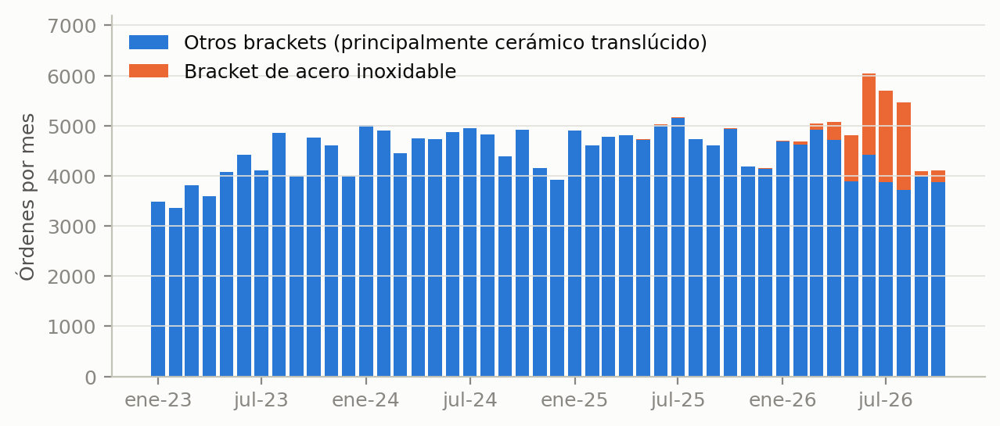{width=75%}

**Figura 1.** El volumen se estabiliza en 2024 y 2025 entre 3,920 y 5,161 órdenes por mes. En 2026 el acero llega al 27 % del mes en junio y al 32 % en julio y agosto, y cae a 3 % en septiembre. **Implicación:** el acero es un cambio de nivel causado por decisiones de capacidad; se modela con su proporción como variable de intervención y la validación se separa en marzo de 2026.

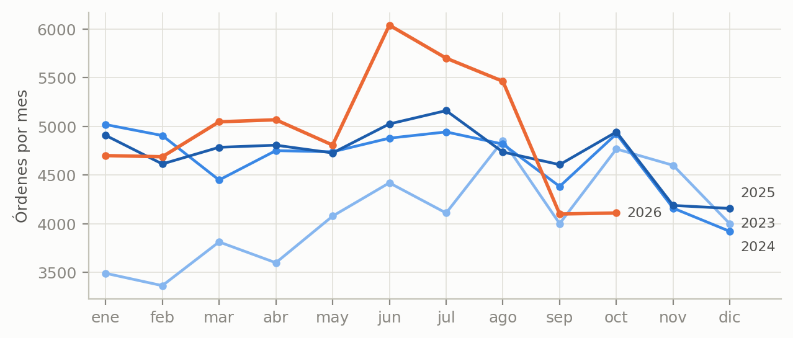{width=75%}

**Figura 2.** Los trazos de 2024 y 2025 son casi iguales: los meses más bajos son noviembre (índice 0.89 respecto del promedio de su año) y diciembre (0.86), y los más altos enero y junio (1.06), julio (1.08) y octubre (1.05). **Implicación:** el patrón anual es repetible y de amplitud moderada (±10 %), así que repetir el mes del año anterior será una referencia difícil de superar. Parte de esas diferencias se debe a los días hábiles (20 a 23, ±7 %), lo que motiva el ajuste por día hábil.

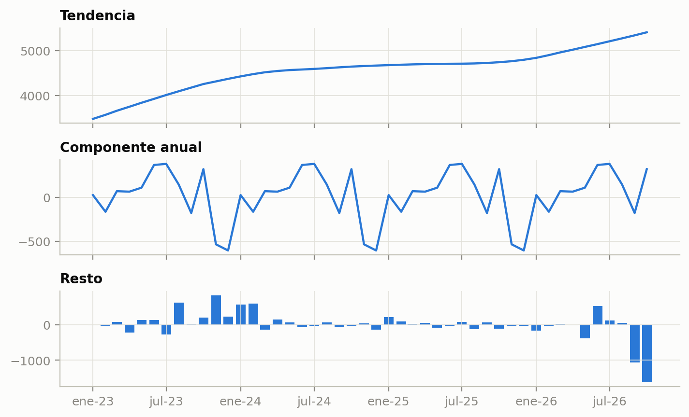{width=75%}

**Figura 3.** La fuerza de la tendencia es 0.38 y la de la estacionalidad anual 0.28 (de 0 a 1), debilitadas por los restos de septiembre (−1,058) y octubre de 2026 (−1,614), efecto de la pausa del acero. La autocorrelación es 0.51 en el rezago 1 y 0.15 en el 12. **Implicación:** con menos de cuatro ciclos la estacionalidad se estima con poca precisión. ADF y KPSS no coinciden sobre la serie original (p = 0.002 y 0.02) y sí tras $(1-B)(1-B^{12})$ (p < 0.001 y ≥ 0.10).

## 4.3 Escala diaria

La serie diaria tiene 1,411 días y 213,358 órdenes (del 1 de enero de 2023 al 11 de noviembre de 2026).

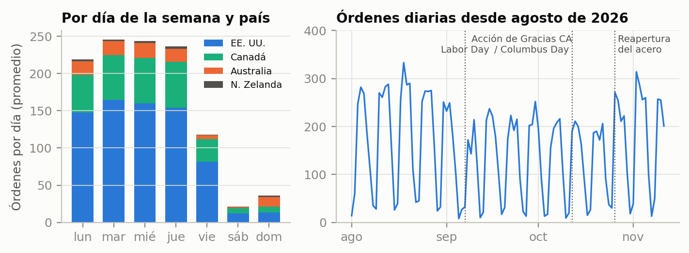{width=88%}

**Figura 4.** El patrón semanal domina la serie diaria: la fuerza de la estacionalidad semanal (STL, período 7) es 0.89. De lunes a jueves llegan entre 219 y 246 órdenes por día, el viernes 118 (muchos consultorios de ortodoncia atienden de lunes a jueves), el sábado 21 y el domingo 36. Aun así, de lunes a viernes el coeficiente de variación diario es 0.32, por los feriados y por el acero. Australia y Nueva Zelanda aportan el 41 % de las órdenes del domingo en hora de Costa Rica, porque su lunes empieza cuando en Costa Rica todavía es domingo (Australia oriental va 16 o 17 horas adelante y Nueva Zelanda 18 o 19). En el tramo de la derecha se ven el Labor Day de EE. UU., la Acción de Gracias de Canadá y la reapertura del acero el 26 de octubre. **Implicación:** el pronóstico diario debe partir de un perfil por día de la semana y país, y no de una suavización de la serie total.

**Feriados y desfase horario.** Se usan los calendarios de la librería `holidays` (vacanza, 2026): EE. UU. (federales), Canadá (Ontario, la provincia con más cuentas), Australia y Nueva Zelanda. Como los días de Australia y Nueva Zelanda empiezan el día anterior en hora de Costa Rica, se probó a qué fecha de Costa Rica asignar sus feriados. En los 22 feriados australianos entre semana, el mismo día de Costa Rica recibe el 59 % de las órdenes normales del país y el día anterior el 24 %; en los 33 neozelandeses, 20 % y 0 %. Es decir, la caída está en el día anterior, y por eso **los feriados de Australia y Nueva Zelanda se desplazan un día hacia atrás**. Al calendario se agregan días que no son feriados oficiales pero que bajan la demanda en EE. UU. y Canadá: Black Friday, la víspera de Thanksgiving, el 24 y del 26 al 31 de diciembre y el 2 de enero. En total hay 109 eventos en EE. UU., 80 en Canadá, 35 en Australia y 63 en Nueva Zelanda de 2023 a 2027.

| País | Evento (factor $f_p$, ocurrencias) |
|---------|-------------------------------------------------------------------------------------------|
| EE. UU. | Navidad (0.02, 3), Año Nuevo (0.07, 3), Thanksgiving (0.08, 3), Labor Day (0.12, 4), 4 de julio (0.17, 5), Black Friday (0.19, 3) |
| Canadá | Año Nuevo (0.00, 3), Navidad (0.02, 3), Victoria Day (0.08, 4), 31 de diciembre (0.09, 3), Labour Day (0.11, 4), Boxing Day (0.14, 3) |
| Australia | Navidad y Año Nuevo (0.00, 3), Easter Monday (0.04, 4), Boxing Day (0.06, 3), Australia Day (0.44, 3), Good Friday (0.51, 4) |
| Nueva Zelanda | Anzac Day, Navidad, Boxing Day, 2 de enero, Easter Monday y Good Friday (0.00) |

Tabla 2. Factores de feriado con los datos hasta el 11 de noviembre de 2026: órdenes del país ese día como proporción de un día normal (sección 5.3). Se muestran los eventos de mayor efecto con al menos dos ocurrencias.

**Implicación:** un feriado nacional elimina casi toda la demanda del país ese día (factores entre 0 y 0.2), así que en las semanas con feriado de EE. UU. el total del día cae a menos de un tercio. Un modelo diario que no sepa qué días son feriado en cada país va a fallar justo en esas semanas, que son las que más cuesta planificar.

**Acero a escala semanal.** La proporción semanal de acero sube de 0.01 a inicios de 2026 a 0.10 a inicios de mayo, 0.25 en junio y 0.30 a 0.36 en julio y agosto. Baja a 0.14 en la semana del cierre (6 de septiembre) y a menos de 0.03 hasta la reapertura, y vuelve a 0.20 y 0.34 en las dos semanas siguientes. **Implicación:** en el horizonte de 15 días la proporción reciente es una buena estimación del estado del acero; Chronos-2 la recibe como covariable con el promedio de los últimos 14 días.

# 5. Formulación matemática

## 5.1 Escala mensual

**Variables.** Sea $y_t \in \mathbb{N}$ el número de órdenes del mes $t$, con $t = 1, \dots, T$ y $T = 46$, $d_t$ sus días hábiles y $x_t = \text{acero}_t / y_t$ la proporción de acero. Se busca $\hat y_{T+h \mid T}$ para $h = 1, 2, 3$. El período estacional es $m = 12$ y $B$ es el operador de rezago.

**Método 1, clásico.**

- *Ingenuo estacional por día hábil (SNAIVE_dh):* $\hat y_{T+h} = d_{T+h}\; y_{T+h-12} / d_{T+h-12}$. La referencia sin ajuste es SNAIVE, $\hat y_{T+h} = y_{T+h-12}$.
- *SARIMA por día hábil (SARIMA_dh):* se modela la tasa $r_t = y_t / d_t$ con un SARIMA$(p,d,q)(P,D,Q)_{12}$,
$$\phi(B)\,\Phi(B^{12})\,(1-B)^d(1-B^{12})^D\, r_t = c + \theta(B)\,\Theta(B^{12})\,\varepsilon_t,$$
con órdenes elegidos por AutoARIMA (pruebas de raíz unitaria y AICc; Hyndman y Khandakar, 2008) y coeficientes por máxima verosimilitud; luego $\hat y_{T+h} = d_{T+h}\,\hat r_{T+h}$.

**Método 2, modelo de fundación (Chronos-2).** $\hat y_{T+h}$ es la mediana de la distribución predictiva $f_\theta(y_1,\dots,y_T;\, \mathbf{z}_1, \dots, \mathbf{z}_{T+h})$, con $\theta$ preentrenado y sin ajuste a estos datos (Ansari et al., 2025). Se corre univariado, con $d_t$ como covariable conocida (Chronos-2_dh) y con $d_t$ y $x_t$ (Chronos-2_ac).

**Contrastes.** AutoETS (con y sin ajuste por día hábil), Ridge (tendencia lineal, mes del año y $d_t$; Hoerl y Kennard, 1970), Prophet (tendencia por tramos y estacionalidad de Fourier; Taylor y Letham, 2018), TimesFM 2.5 (Das et al., 2024) y el ingenuo $\hat y_{T+h} = y_T$.

## 5.2 Variable de intervención del acero

El quiebre del acero se modela con una regresión con errores SARIMA sobre la tasa por día hábil (Box y Tiao, 1975; Hyndman y Athanasopoulos, 2021, cap. 10):
$$r_t = \beta\, x_t + \eta_t, \qquad \eta_t \sim \text{SARIMA}(p,d,q)(P,D,Q)_{12}, \qquad \hat y_{T+h} = d_{T+h}\,(\hat\beta\, x_{T+h} + \hat\eta_{T+h}).$$
Este es el **SARIMAX_dh**. Se usa la proporción $x_t$ en lugar de una indicadora 0/1 porque el acero no se encendió de golpe: pasó de 0.01 en febrero a 0.32 en julio, y una indicadora no captaría esa rampa. Con la misma $x_t$ se amplían Ridge (Ridge_ac) y Chronos-2 (Chronos-2_ac). La intervención solo entra cuando $x_t$ ya varía en el entrenamiento (desviación estándar mayor que 0.01, desde los orígenes de 2026); antes, cada modelo coincide con su versión sin intervención.

**Cómo se construye $x_{T+h}$ en el horizonte.** La proporción futura no se observa al emitir el pronóstico, así que se comparan dos construcciones:

- *Persistencia:* $x_{T+h} = x_T$, la proporción del último mes observado. No usa información externa.
- *Plan de capacidad:* el valor que corresponde a la decisión de capacidad vigente. La empresa decide con anticipación cuándo abre o cierra la recepción de acero (el cierre de septiembre y la reapertura del 26 de octubre se comunicaron antes de aplicarse), así que quien planifica conoce el estado del acero en el horizonte. En la validación se aproxima con la proporción realizada; es una cota optimista, porque además del estado abierto o cerrado incluye la velocidad real de adopción. En el pronóstico final se usa la proporción observada desde la reapertura (0.258).

## 5.3 Escala diaria

**Variables.** Sea $y_t$ el número de órdenes del día $t$ (hora de Costa Rica), $y_{p,t}$ las del país $p \in \{\text{US}, \text{CA}, \text{AU}, \text{NZ}\}$ y $w_t$ el día de la semana. Desde el origen $T$ se busca $\hat y_{T+h}$ para $h = 1, \dots, 15$.

**Factores de feriado.** Para cada evento $e$ del calendario del país $p$ (sección 4.3), el factor $f_p(e)$ es la mediana, en sus ocurrencias hasta $T$, del cociente entre $y_{p,t}$ y la mediana del mismo día de la semana en las cuatro semanas anteriores sin feriados; se acota en 1.5. En días sin evento, $f_p(t) = 1$.

**Método 1, descomposición clásica con reparto del pronóstico mensual (A1).** El nivel esperado del país $p$ el día $t$ es $n_{p,t} = s_p(w_t)\, f_p(t)$, donde $s_p(w)$ es el promedio del país en el día de la semana $w$ en las últimas 26 semanas, sin feriados. Con $\hat Y_M$ el pronóstico SNAIVE_dh del mes $M$ (parte 1), cada día recibe su parte:
$$\hat y_t = \hat Y_{M(t)} \; \frac{\sum_p n_{p,t}}{\sum_{u \in M(t)} \sum_p n_{p,u}}.$$
Es un pronóstico jerárquico *top-down* con proporciones pronosticadas (Hyndman y Athanasopoulos, 2021, cap. 11). Variantes: A2 reparte en el mes en curso solo lo que falta, $\max(0, \hat Y_M - \text{observado})$; P4, P8 y P26 usan directamente $\hat y_t = \sum_p n_{p,t}$ con el perfil de 4, 8 o 26 semanas, sin pronóstico mensual.

**Método 2, Chronos-2 con covariables.** Chronos-2 recibe la historia diaria completa y cinco covariables conocidas en el horizonte: la pérdida esperada por feriado de cada país, $1 - f_p(t)$, y la proporción de acero. Para el acero se usa la **persistencia** del promedio de los últimos 14 días (la misma idea de la sección 5.2); como cota, se corre también con la proporción diaria realizada, que representa conocer el plan.

**Pronóstico final, combinación C.** $\hat y^{C}_t = \tfrac12\,(\hat y^{A1}_t + \hat y^{\text{Chronos}}_t)$. A1 conoce los feriados y el total del mes, pero su perfil es rígido; Chronos-2 sigue mejor el nivel reciente, pero en los feriados solo tiene la covariable. Promediar pronósticos con errores distintos suele reducir el error (Hyndman y Athanasopoulos, 2021, sec. 13.4).

**Contrastes.** Ingenuo semanal SN7, $\hat y_{T+h} = y_{T+h-7k}$ con $k = \lceil h/7 \rceil$ (referencia); AutoETS con $m = 7$; MSTL con períodos 7 y 365 (Bandara et al., 2021); SARIMAX semanal con las mismas covariables de Chronos-2; Prophet con estacionalidad semanal y anual multiplicativas, un efecto por feriado y país y el acero como regresor; Chronos-2 univariado; TimesFM 2.5; y LightGBM (Ke et al., 2017) recursivo con rezagos de 1, 7, 14, 21 y 28 días, medias móviles, día de la semana, mes y las covariables.

## 5.4 Restricciones, supuestos, métricas y validación

**Restricciones.** (i) $y_t \ge 0$: todo pronóstico se trunca en cero, $\hat y^{+}_{t} = \max(0, \hat y_t)$. (ii) En los SARIMA, estacionariedad e invertibilidad: las raíces de los polinomios quedan fuera del círculo unitario. (iii) En A1, los pronósticos diarios de cada mes suman $\hat Y_M$. (iv) Validación sin fuga: cada pronóstico usa solo datos anteriores a su origen, y cada modelo, perfil y factor de feriado se vuelve a estimar en cada origen.

**Supuestos y su justificación.**

- *Período anual fijo ($m = 12$):* el índice de 2024 y 2025 es casi idéntico (Figura 2).
- *Proporcionalidad a los días hábiles:* las órdenes llegan casi solo de lunes a viernes (sección 4.3).
- *Perfil semanal estable por país en el corto plazo:* se verifica comparando perfiles de 4, 8 y 26 semanas (P4, P8 y P26).
- *Feriados repetibles:* el efecto de un feriado se parece al de sus ocurrencias anteriores; se acota en 1.5 para limitar eventos atípicos.
- *El acero entra como proporción:* su efecto sobre la tasa es lineal en $x_t$; las decisiones de capacidad se conocen con anticipación (escenario de plan).
- *Innovaciones no correlacionadas:* se verifica con Ljung-Box sobre los residuos del SARIMA.

**Métricas.** Con $e_t = y_t - \hat y^{+}_t$ y $n$ pronósticos,
$$\text{MAE} = \frac{1}{n}\sum |e_t|, \qquad \text{RMSE} = \sqrt{\frac{1}{n}\sum e_t^2}, \qquad \text{MASE} = \frac{\text{MAE}}{\frac{1}{n_0 - m}\sum_{t=m+1}^{n_0} |y_t - y_{t-m}|},$$
donde el denominador es el error del ingenuo estacional en el entrenamiento ($n_0$ períodos; $m = 12$ en la escala mensual y $m = 7$ en la diaria). Un MASE menor que 1 supera a ese ingenuo (Hyndman y Koehler, 2006). Se calcula por origen y se promedia. En la escala diaria se agregan el error porcentual absoluto del total de los 15 días y el MASE en los días con feriado de EE. UU. o Canadá. La **cobertura** de un intervalo es la proporción de pronósticos con el valor real dentro de él; un intervalo bien calibrado del 80 % debe cubrir cerca del 80 %.

**Validación.** *Mensual:* ventana expansiva; el primer entrenamiento va de enero de 2023 a diciembre de 2024 y pronostica tres meses; se agrega un mes por ventana hasta pronosticar agosto a octubre de 2026 (20 ventanas, 60 pronósticos por modelo). Los resultados se separan según el origen: antes de marzo de 2026 (15 ventanas) y desde marzo (5). *Diaria:* 52 orígenes, los domingos del 2 de noviembre de 2025 al 25 de octubre de 2026, cada uno a 15 días (780 días por método), que cubren un año completo de feriados y el auge y la pausa del acero. **Criterio de éxito:** MASE menor que 1 y menor que el de la referencia en la mayoría de los orígenes, confirmado con la prueba de Wilcoxon pareada (Wilcoxon, 1945).

# 6. Resultados de la parte 1: pronóstico mensual

Todo se calculó en el notebook 1 (Python 3.12, `statsforecast` 2.1.1, `statsmodels`, `prophet` 1.5.0, `chronos-forecasting` 2.3.2, `timesfm` 3.0.2, semilla 2026). En esta parte, el **método 1** es el clásico (SNAIVE_dh y SARIMA_dh, con su extensión SARIMAX_dh), el **método 2** es Chronos-2 y los demás son contraste.

## 6.1 Validación de los modelos sin intervención

| Modelo | MAE | MASE | MASE antes | MASE desde | Gana | p | Sesgo |
|---------------------------------------|---------|-------|---------|---------|-------|------------|---------|
| **SNAIVE_dh** (método 1) | **234.6** | **0.56** | **0.25** | 1.52 | 14 | 0.008 | −163 |
| SARIMA_dh (método 1) | 283.5 | 0.63 | 0.43 | **1.25** | 8 | 0.55 | −49 |
| SNAIVE (ref.) | 268.7 | 0.65 | 0.33 | 1.61 | – | – | −154 |
| SARIMA | 306.8 | 0.70 | 0.39 | 1.62 | 10 | 0.76 | −48 |
| Ridge | 301.1 | 0.71 | 0.50 | 1.34 | 10 | 0.70 | +74 |
| Prophet | 337.5 | 0.76 | 0.52 | 1.48 | 4 | 0.040 | −112 |
| AutoETS_dh | 352.0 | 0.81 | 0.58 | 1.49 | 4 | 0.014 | −88 |
| TimesFM 2.5 | 357.4 | 0.84 | 0.54 | 1.71 | 3 | 0.001 | −86 |
| Chronos-2_dh (método 2) | 393.0 | 0.91 | 0.60 | 1.83 | 2 | < 0.001 | −150 |
| AutoETS | 374.8 | 0.91 | 0.48 | 2.19 | 4 | 0.002 | −112 |
| Chronos-2 | 403.7 | 0.92 | 0.67 | 1.67 | 2 | < 0.001 | −90 |
| Ingenuo | 465.8 | 1.09 | 0.74 | 2.14 | 2 | < 0.001 | −42 |

Tabla 3. Validación a 3 meses (20 ventanas, 60 pronósticos por modelo). MASE antes y desde: ventanas con origen antes de marzo de 2026 (15) y desde marzo (5). Gana: ventanas con MASE menor que SNAIVE. p: Wilcoxon contra SNAIVE. MAE y sesgo en órdenes por mes.

- *El mejor modelo es SNAIVE_dh,* el único que cumple todo el criterio de éxito: MASE de 0.56, menor que el de SNAIVE en 14 de 20 ventanas (p = 0.008). A SARIMA_dh le gana en 13 de 20 (p = 0.14, no significativo). El error crece con el horizonte (MASE 0.51, 0.56 y 0.63 a uno, dos y tres meses).
- *El ajuste por días hábiles mejora a los tres clásicos* (SNAIVE de 0.65 a 0.56, SARIMA de 0.70 a 0.63, AutoETS de 0.91 a 0.81) y casi no cambia a Chronos-2 (0.92 a 0.91).
- *Chronos-2 y TimesFM no superan a las referencias:* son mejores que el ingenuo, pero a SNAIVE solo le ganan en 2 o 3 ventanas. Con 24 a 43 meses de contexto suavizan el patrón anual, que aquí es lo más predecible.
- *Desde marzo de 2026 todos fallan* (MASE entre 1.25 y 2.19): a tres meses, los modelos pronosticaron entre 4,600 y 5,700 órdenes para septiembre y octubre, contra unas 4,100 observadas (Figura 5).

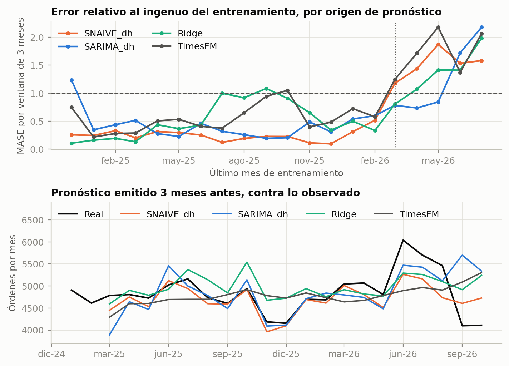{width=75%}

## 6.2 Variable de intervención del acero

| Modelo | MASE | MASE antes | MASE desde | Gana a SNAIVE_dh | p | Sesgo desde |
|-----------------------------------------|--------|--------|--------|---------------|-----------|--------|
| SNAIVE_dh | 0.564 | 0.246 | 1.519 | – | – | −356 |
| SARIMA_dh | 0.633 | 0.426 | 1.252 | 7 | 0.14 | +100 |
| SARIMAX_dh, persistencia | 0.615 | 0.426 | 1.181 | 8 | 0.31 | +44 |
| **SARIMAX_dh, plan** | **0.543** | 0.426 | **0.895** | 9 | 0.62 | +119 |
| Ridge_ac, persistencia | 0.700 | 0.503 | 1.289 | 9 | 0.28 | +55 |
| Ridge_ac, plan | 0.631 | 0.503 | 1.014 | 9 | 0.60 | +69 |
| Chronos-2_ac, persistencia | 1.005 | 0.697 | 1.931 | 0 | < 0.001 | −46 |
| Chronos-2_ac, plan | 0.978 | 0.708 | 1.788 | 1 | < 0.001 | −101 |

Tabla 4. Modelos con la proporción de acero como variable de intervención, con las dos construcciones de $x_{T+h}$ de la sección 5.2. Gana y p: contra SNAIVE_dh (Wilcoxon, 20 ventanas). Sesgo desde: órdenes por mes en las ventanas con origen desde marzo de 2026.

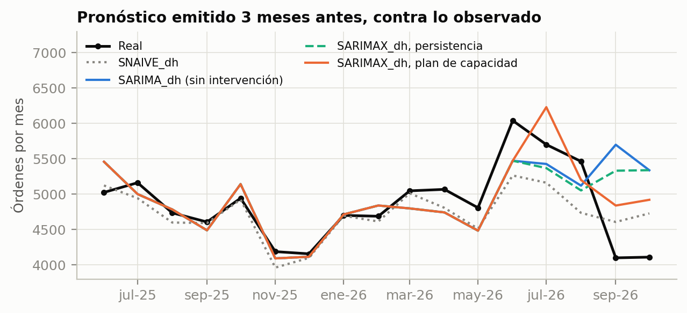{width=75%}

- *Con el plan de capacidad, la intervención corrige buena parte del quiebre.* En las ventanas desde marzo de 2026, SARIMAX_dh con el plan baja el MASE de SARIMA_dh de 1.25 a 0.89 (gana en 3 de 5) y Ridge de 1.34 a 1.01 (gana en 4 de 5). En el promedio de las 20 ventanas, SARIMAX_dh con el plan (0.543) queda por debajo de SNAIVE_dh (0.564), aunque la diferencia no es significativa (p = 0.62). Antes de marzo coincide con SARIMA_dh porque el acero todavía no variaba.
- *Con persistencia la mejora es mínima* (1.25 a 1.18, gana en 1 de 5). La Figura 6 muestra por qué: al pronosticar septiembre desde junio, la persistencia supone que el acero sigue en 0.27 y el pronóstico queda en unas 5,300 órdenes; el cierre de septiembre no se puede anticipar con la proporción de agosto.
- *Chronos-2 no aprovecha la covariable de acero a escala mensual* (1.83 a 1.79): con tan pocos meses en que el acero varía, el modelo casi no la usa.
- **Implicación:** la intervención solo vale lo que valga la información sobre el plan. En el pronóstico final se usa el escenario de reapertura (proporción desde el 26 de octubre, 0.258), que es el estado vigente del acero.

## 6.3 Cobertura de los intervalos

| Intervalo | Cob. 80 % | Antes / desde | Ancho 80 % | Cob. 95 % | Antes / desde | Ancho 95 % |
|---------------------------------------|------|----------------|---------|------|----------------|---------|
| SNAIVE_dh, empírico (avance) | 0.54 | 0.88 / 0.00 | 6.9 % | 0.72 | 1.00 / 0.27 | 9.6 % |
| **SNAIVE_dh, del modelo** | **0.90** | 1.00 / 0.60 | 32.9 % | **1.00** | 1.00 / 1.00 | 50.3 % |
| SARIMA_dh | 0.83 | 0.91 / 0.60 | 19.3 % | 0.93 | 0.98 / 0.80 | 29.5 % |
| SARIMAX_dh, plan | 0.83 | 0.91 / 0.60 | 19.2 % | 0.93 | 0.98 / 0.80 | 29.3 % |
| AutoETS_dh | 0.72 | 0.80 / 0.47 | 16.8 % | 0.83 | 0.91 / 0.60 | 25.7 % |
| Prophet | 0.25 | 0.24 / 0.27 | 5.2 % | 0.33 | 0.36 / 0.27 | 8.1 % |
| Chronos-2_dh | 0.68 | 0.80 / 0.33 | 22.3 % | 0.88 | 1.00 / 0.53 | 40.8 % |
| TimesFM 2.5 | 0.77 | 0.89 / 0.40 | 22.0 % | – | – | – |

Tabla 5. Cobertura observada en la validación: proporción de los 60 pronósticos (39 en el empírico, que necesita seis orígenes previos) con el valor real dentro del intervalo. Antes / desde: ventanas con origen antes y desde marzo de 2026. Ancho: ancho medio como porcentaje del pronóstico. TimesFM solo entrega cuantiles del 10 % al 90 %.

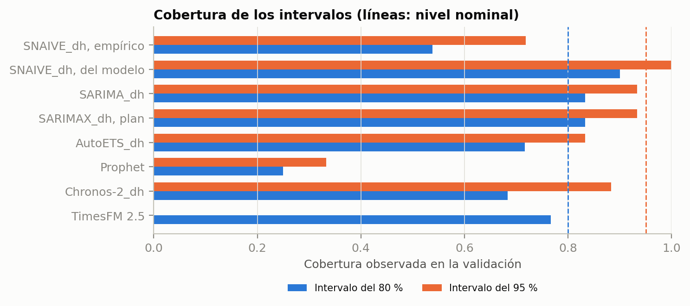{width=75%}

- *El intervalo empírico del avance subcubre:* contiene el valor real en el 54 % de los casos para el nivel del 80 % y en el 72 % para el del 95 %. Se calibró con los errores pequeños de 2025 y no cubrió ninguno de los meses afectados por el acero. Por eso se reemplaza.
- *El intervalo del propio SNAIVE_dh* (basado en la dispersión de las diferencias estacionales) cubre el 90 % y 100 %: es conservador, pero es el único que mantiene la cobertura del 95 % también desde marzo de 2026. El de SARIMA_dh es el más cercano al nominal (83 % y 93 %) con un ancho de 19 % del pronóstico.
- *Prophet da intervalos demasiado estrechos* (5 % del pronóstico, 25 % de cobertura al 80 %). Chronos-2, con un ancho similar al de SARIMA_dh, cubre menos (68 %) porque su pronóstico está sesgado hacia abajo (sesgo de −150 órdenes por mes).
- **Decisión:** el pronóstico oficial se publica con el intervalo del modelo SNAIVE_dh. Para planificar capacidad conviene más un intervalo ancho que cumpla su nivel que uno angosto que no lo cumple.

## 6.4 Diagnóstico y pronóstico de noviembre de 2026 a enero de 2027

*Diagnóstico del SARIMA_dh.* El orden elegido es inestable entre ventanas: $(0,1,0)(0,1,0)_{12}$ en 11, $(0,1,0)(1,1,0)_{12}$ en 5 y otros tres en las 4 restantes. Con los 46 meses queda $(1-B)(1-B^{12})\,r_t = \varepsilon_t$, cuyos residuos son compatibles con ruido blanco (Ljung-Box p = 0.40 con 6 rezagos y 0.68 con 12; $n = 33$). Que el mejor SARIMA sea casi un ingenuo estacional sobre la tasa explica por qué SNAIVE_dh es tan difícil de superar.

| Mes (días háb.) | SNAIVE_dh | 80 % | 95 % | SARIMA_dh | SARIMAX pers. | SARIMAX reap. (80 %) |
|----------------|----------|---------------|---------------|----------|--------|------------------------|
| Nov. 2026 (21) | 4,396 | 3,73 a ,054 | 3,39 a ,402 | 3,806 | 3,701 | 4,431 (4,15 a ,705) |
| Dic. 2026 (23) | 4,156 | 3,43 a ,876 | 3,05 a ,257 | 3,510 | 3,487 | 4,286 (3,86 a ,711) |
| Ene. 2027 (21) | 4,485 | 3,82 a ,143 | 3,48 a ,491 | 3,895 | 3,894 | 4,624 (4,14 a ,099) |
| **Total** | **13,038** | | | 11,211 | 11,081 | 13,340 |

Tabla 6. Pronóstico de noviembre de 2026 a enero de 2027 con los 46 meses. 80 % y 95 %: intervalos del modelo SNAIVE_dh. SARIMAX_dh con la proporción de acero de octubre (persistencia, 0.058) y con la observada desde la reapertura (0.258).

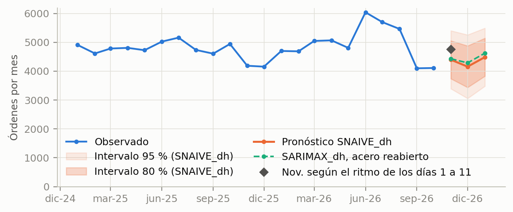{width=75%}

**Pronóstico adoptado: SNAIVE_dh, 13,038 órdenes en el trimestre.** Dos comprobaciones independientes lo respaldan. (i) El SARIMAX_dh con el acero reabierto da 13,340 (2.3 % más), mientras que los modelos que suponen que el acero sigue cerrado (SARIMA_dh y SARIMAX_dh con persistencia) dan unas 11,100 a 11,200, porque arrastran el nivel bajo de septiembre y octubre. (ii) Del 1 al 11 de noviembre de 2026 llegaron 2,033 órdenes, 8 % más por día hábil que en 2025, lo que proyecta cerca de 4,750 en noviembre: dentro del intervalo del 80 % y por encima del pronóstico puntual. Si el acero sigue abierto, lo esperable es que el trimestre quede en la parte alta del intervalo.

# 7. Resultados de la parte 2: pronóstico diario

Todo se calculó en el notebook 2 (además de las librerías del notebook 1: `holidays` 0.107, `mlforecast` 1.1.0 y `lightgbm` 4.7.0; semilla 2026). Los 52 orígenes tardan unos 12 minutos en CPU. En esta parte, el **método 1** es A1, el reparto del pronóstico mensual; el **método 2** es Chronos-2 con covariables; el **pronóstico final** es su combinación C; y los demás son contraste.

## 7.1 Validación a 15 días

| Método | MASE | Días 1–7 | Días 8–15 | En feriados | Gana a SN7 | Error total 15 d | Sesgo |
|-------------------------------------------|-------|-------|-------|------------|------|---------|-------|
| Chronos-2 cov., plan (cota) | 0.663 | 0.635 | 0.688 | 1.060 | 49 | 5.1 % | +0.3 |
| **C** (combinación) | **0.680** | 0.641 | 0.714 | 0.865 | 46 | **6.0 %** | −2.7 |
| **Chronos-2 cov.** (método 2) | 0.701 | 0.654 | 0.741 | 1.098 | 48 | 6.1 % | +0.4 |
| LightGBM | 0.716 | 0.683 | 0.745 | 0.784 | 45 | 7.2 % | +2.6 |
| **A1** (método 1) | 0.737 | 0.714 | 0.757 | **0.732** | 39 | 7.7 % | −5.8 |
| P8 | 0.743 | 0.703 | 0.778 | 0.776 | 43 | 8.1 % | +1.1 |
| P4 | 0.745 | 0.700 | 0.785 | 0.809 | 43 | 7.1 % | +0.2 |
| Prophet | 0.763 | 0.738 | 0.784 | 1.011 | 43 | 7.4 % | +4.7 |
| TimesFM 2.5 | 0.774 | 0.727 | 0.816 | 1.518 | 45 | 7.3 % | −1.6 |
| SARIMAX | 0.777 | 0.754 | 0.797 | 1.328 | 43 | 7.4 % | +2.2 |
| P26 | 0.780 | 0.758 | 0.799 | 0.767 | 40 | 9.2 % | −0.4 |
| Chronos-2 (sin covariables) | 0.791 | 0.707 | 0.863 | 1.381 | 44 | 7.3 % | −3.6 |
| MSTL | 0.902 | 0.856 | 0.943 | 1.696 | 36 | 7.7 % | +1.2 |
| A2 | 0.971 | 1.108 | 0.851 | 0.760 | 33 | 11.6 % | −8.5 |
| AutoETS | 0.997 | 0.934 | 1.053 | 2.803 | 40 | 15.1 % | −6.3 |
| SN7 (referencia) | 1.131 | 1.031 | 1.219 | 2.855 | – | 14.5 % | −0.5 |

Tabla 7. Validación diaria: 52 orígenes semanales, 780 días por método, 57 de ellos con evento en EE. UU. o Canadá. MASE: promedio de los 52 orígenes. En feriados: MASE en los días con evento. Gana a SN7: orígenes con MASE menor que el ingenuo semanal (en todos los métodos salvo A2, Wilcoxon p ≤ 0.003). Error total 15 d: error porcentual absoluto medio del total de los 15 días. Sesgo: órdenes por día. "Plan (cota)" usa la proporción de acero realizada y no es un pronóstico factible.

| Comparación (Wilcoxon pareada, 52 orígenes) | Gana en | MASE | p |
|------------------------------------------------------------------|------|------------------|----------|
| C contra A1 | 34 | 0.680 / 0.737 | 0.006 |
| C contra Chronos-2 cov. | 26 | 0.680 / 0.701 | 0.34 |
| Chronos-2 cov. contra A1 | 31 | 0.701 / 0.737 | 0.21 |
| Chronos-2 cov. contra Chronos-2 sin covariables | 36 | 0.701 / 0.791 | < 0.001 |
| Chronos-2 cov. contra LightGBM | 30 | 0.701 / 0.716 | 0.30 |
| A1 contra P26 (efecto del pronóstico mensual) | 28 | 0.737 / 0.780 | 0.37 |
| A1 contra A2 | 36 | 0.737 / 0.971 | < 0.001 |
| Chronos-2 cov., plan contra persistencia | 36 | 0.663 / 0.701 | < 0.001 |

Tabla 8. Comparaciones pareadas entre los métodos principales.

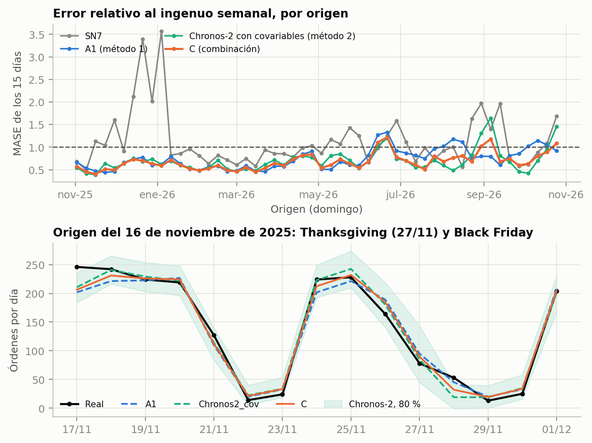{width=75%}

- *Los dos métodos cumplen el criterio de éxito:* MASE menor que 1 y menor que el del ingenuo semanal en la mayoría de los orígenes (48 y 39 de 52). Su diferencia no es significativa (p = 0.21), pero sus fortalezas son distintas: Chronos-2 sigue mejor el nivel reciente (sesgo cercano a cero), mientras que A1 es el mejor en los feriados (0.732), porque conoce el calendario de cada país y el factor de cada evento.
- *Las covariables son las que hacen útil a Chronos-2:* sin ellas pasa de 0.701 a 0.791 (p < 0.001) y su error en feriados sube de 1.10 a 1.38. Los modelos de fundación sin covariables (Chronos-2 y TimesFM) son, junto con SARIMAX, los que más fallan en feriados entre los métodos con MASE menor que 0.8.
- *La combinación C es la mejor opción factible:* supera a A1 en 34 de 52 orígenes (p = 0.006), es equivalente a Chronos-2 en el promedio y reduce su error en feriados de 1.10 a 0.87. Promediar dos pronósticos con errores poco correlacionados da un resultado más estable que elegir uno.
- *El pronóstico mensual aporta poco al diario:* A1 apenas mejora a P26, el mismo perfil sin pronóstico mensual (p = 0.37). A2 empeora (0.971): en 2026 el pronóstico mensual erró por el acero, y al descontar lo ya observado todo el error se concentra en los días que quedan del mes (en el origen del 21 de junio, A2 pronosticó 179 a 216 órdenes en días que tuvieron 290 a 369).
- *Conocer el plan del acero mejora el pronóstico diario* (0.701 a 0.663, p < 0.001), igual que en la escala mensual.
- *Contrastes:* LightGBM es competitivo (0.716) y bueno en feriados (0.784); Prophet, TimesFM y SARIMAX quedan detrás de los dos métodos; MSTL y ETS apenas superan al ingenuo semanal.

## 7.2 Cobertura de los intervalos diarios

El intervalo de C es **empírico secuencial**: en cada origen se toman los cocientes $y/\hat y$ de los orígenes anteriores, separados en dos bloques de horizonte (días 1–7 y 8–15), y sus cuantiles se aplican al pronóstico. Solo usa información disponible en el origen y se evalúa desde el cuarto origen (735 días).

| Intervalo | Cob. 80 % | En feriados | Ancho 80 % | Cob. 95 % | En feriados | Ancho 95 % |
|---------------------------------------------------|------|-----------|-------|------|-----------|-------|
| **C, empírico** | **0.77** | 0.40 | 84 | **0.93** | 0.60 | 164 |
| A1, empírico | 0.75 | 0.46 | 79 | 0.92 | 0.67 | 163 |
| Chronos-2 cov., empírico | 0.75 | 0.37 | 87 | 0.91 | 0.56 | 201 |
| Chronos-2 cov., cuantiles del modelo | 0.73 | 0.50 | 54 | 0.94 | 0.87 | 102 |
| Chronos-2, cuantiles del modelo | 0.73 | 0.69 | 59 | 0.94 | 0.87 | 112 |
| TimesFM 2.5 | 0.76 | 0.62 | 62 | – | – | – |
| AutoETS | 0.91 | 0.54 | 148 | 0.96 | 0.69 | 226 |
| MSTL | 0.59 | 0.31 | 50 | 0.75 | 0.40 | 76 |
| SARIMAX | 0.79 | 0.35 | 73 | 0.92 | 0.71 | 112 |
| Prophet | 0.71 | 0.52 | 58 | 0.86 | 0.67 | 88 |

Tabla 9. Cobertura de los intervalos diarios en los 735 días de los orígenes 4 a 52. Ancho medio en órdenes por día.

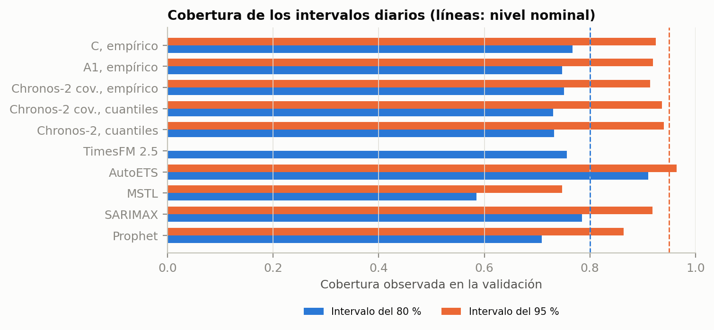{width=75%}

- *Los intervalos de C cubren cerca del nivel nominal* (77 % y 93 %), algo por debajo. Los cuantiles de Chronos-2 con covariables son más angostos (54 contra 84 órdenes al 80 %) y cubren casi lo mismo (73 % y 94 %), así que son una alternativa razonable; se usa el empírico porque corresponde al pronóstico combinado C. SARIMAX es el más cercano al 80 % (0.79), pero con un pronóstico puntual peor.
- *Ningún intervalo cubre bien los feriados* (entre 31 % y 69 % al 80 %): cada feriado tiene pocas ocurrencias pasadas y su efecto varía de un año a otro. **Implicación:** en las semanas con feriado de EE. UU. o Canadá hay que planificar con un margen adicional al del intervalo.

## 7.3 Pronóstico del 12 al 26 de noviembre de 2026

| Día | A1 | Chronos-2 cov. | **C** | C, 80 % | C, 95 % | Evento |
|--------|-------|------------|-------|------------|------------|-------------------------------------------|
| Jue 12 | 229 | 259 | **244** | 179 a 305 | 131 a 367 | |
| Vie 13 | 114 | 126 | **120** | 88 a 150 | 64 a 180 | |
| Sáb 14 | 20 | 25 | **23** | 17 a 28 | 12 a 34 | |
| Dom 15 | 34 | 41 | **38** | 28 a 47 | 20 a 57 | |
| Lun 16 | 224 | 251 | **238** | 174 a 297 | 128 a 357 | |
| Mar 17 | 236 | 253 | **245** | 179 a 305 | 131 a 367 | |
| Mié 18 | 238 | 252 | **245** | 179 a 306 | 131 a 368 | |
| Jue 19 | 229 | 244 | **237** | 172 a 298 | 122 a 360 | |
| Vie 20 | 114 | 121 | **117** | 85 a 147 | 60 a 178 | |
| Sáb 21 | 20 | 21 | **21** | 15 a 26 | 11 a 31 | |
| Dom 22 | 34 | 34 | **34** | 25 a 43 | 18 a 52 | |
| Lun 23 | 224 | 233 | **228** | 166 a 287 | 118 a 347 | |
| Mar 24 | 236 | 243 | **239** | 174 a 301 | 123 a 364 | |
| Mié 25 | 194 | 201 | **197** | 143 a 248 | 102 a 300 | EE. UU.: víspera de Thanksgiving |
| Jue 26 | 94 | 130 | **112** | 81 a 141 | 58 a 170 | EE. UU.: Thanksgiving |
| **Total** | **2,237** | **2,435** | **2,336** | | | |

Tabla 10. Pronóstico diario con los datos hasta el 11 de noviembre de 2026. Proporción de acero en el horizonte (persistencia de 14 días): 0.266.

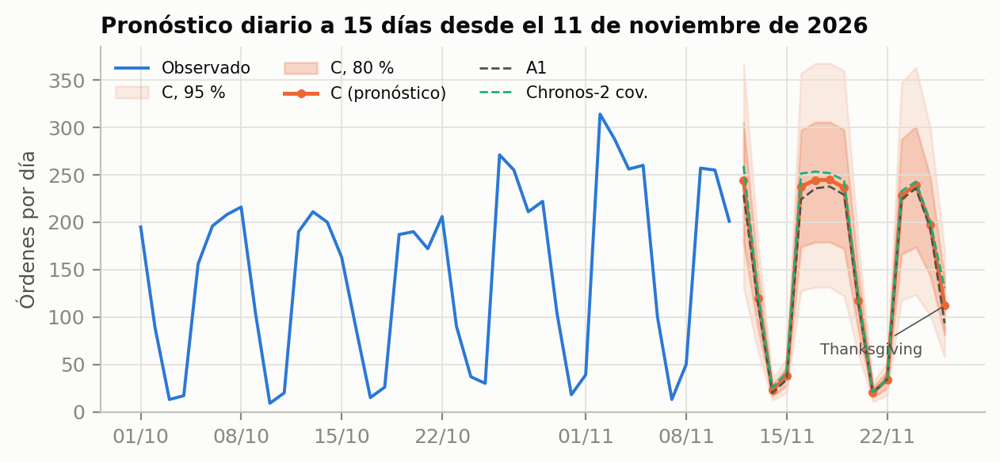{width=75%}

**Pronóstico adoptado: C, 2,336 órdenes en los 15 días**, entre 197 y 245 por día hábil normal, unas 120 los viernes y 112 el día de Thanksgiving. En los mismos días de 2025 llegaron 2,373; la diferencia se debe principalmente a que el 26 de noviembre de 2026 es Thanksgiving, mientras que en 2025 cayó el 27, fuera del tramo. A1 da un total menor (2,237) porque reparte el pronóstico mensual de SNAIVE_dh, que no incluye el repunte de noviembre (sección 6.4); Chronos-2 sigue el nivel reciente con el acero reabierto (2,435). SN7 (2,532) repite las últimas semanas sin descontar Thanksgiving, y LightGBM (2,623) queda por encima de los dos métodos.

# 8. Discusión y limitaciones

**Clásico contra fundación.** La comparación da resultados opuestos según la escala. En la mensual, con 46 observaciones y un patrón anual estable, la regla más simple corregida por calendario (SNAIVE_dh) supera a Chronos-2_dh en 19 de 20 ventanas; el SARIMA elegido es, en la práctica, un ingenuo estacional sobre la tasa. En la diaria, con 1,411 observaciones, Chronos-2 con covariables es el mejor modelo individual. La diferencia no está en el tipo de modelo, sino en la información disponible: con pocos datos, el conocimiento del problema (días hábiles, feriados por país, desfase horario) pesa más que la capacidad del modelo; con más datos, el modelo de fundación aprovecha ese conocimiento si se le entrega como covariable. Sin covariables, Chronos-2 pierde su ventaja en las dos escalas.

**La intervención y el plan.** La variable de intervención resuelve el quiebre del acero solo si se conoce su valor en el horizonte. Con el plan, SARIMAX_dh reduce el error desde marzo de 2026 en 29 %; con persistencia, en 6 %. El escenario de plan de la validación usa la proporción realizada, así que es una cota optimista; en la práctica, la empresa conoce las fechas de apertura y cierre, pero no la velocidad de adopción. Aun así, el resultado tiene una consecuencia operativa clara: si planificación comunica las decisiones de capacidad, el pronóstico mejora en las dos escalas.

**Cobertura.** El intervalo empírico del avance era engañosamente angosto: se calibró en un período estable y no cubrió los cambios de 2026. En la entrega final se publica, en la escala mensual, el intervalo del modelo, que cubre por encima de su nivel, y en la diaria, un intervalo empírico secuencial que cubre cerca del nominal. Ningún método cubre bien los feriados.

**Limitaciones.**

- *Serie mensual corta:* 46 meses, menos de cuatro ciclos anuales. La estacionalidad se estima con poca precisión, las pruebas de Wilcoxon con 20 ventanas tienen poca potencia y solo hay cinco ventanas desde el quiebre.
- *Cota optimista del plan:* el escenario de plan usa información que no estaba disponible en el origen. Su mejora es un límite superior de lo que aporta conocer el plan.
- *Pocas ocurrencias por feriado:* los factores de feriado se estiman con dos a cinco ocurrencias por evento, y eventos como el fin de año pueden cambiar con el calendario.
- *Cambios estructurales futuros:* ningún modelo anticipa nuevas decisiones de capacidad, lanzamientos de productos o cambios en la cartera de doctores.
- *Covariable de acero en la escala diaria:* la persistencia de 14 días supone que el acero sigue en su nivel reciente durante el horizonte; tras la reapertura, ese nivel todavía se está estabilizando.
- *Reproducibilidad de los modelos de fundación:* los resultados de Chronos-2 y TimesFM dependen de las versiones de los pesos; se fijaron las versiones de las librerías y la semilla.

# 9. Conclusiones y recomendaciones

1. **Pronóstico mensual (parte 1).** El método 1, el ingenuo estacional ajustado por días hábiles (SNAIVE_dh), es el mejor: MASE de 0.56 en 20 ventanas, contra 0.91 de Chronos-2. **Pronóstico oficial: 4,396 órdenes en noviembre de 2026, 4,156 en diciembre y 4,485 en enero de 2027 (13,038 en el trimestre)**, con un intervalo del 80 % de entre ±660 y ±720 órdenes por mes. El SARIMAX_dh con el acero reabierto (13,340) y el ritmo de los primeros 11 días de noviembre (+8 %) indican que lo más probable es la parte alta del intervalo.
2. **Pronóstico diario (parte 2).** Los dos métodos superan con claridad al ingenuo semanal: Chronos-2 con covariables (método 2, MASE 0.701) y el reparto con perfil semanal y feriados por país (método 1, 0.737). Su combinación C es el pronóstico final (0.680, error de 6 % en el total de 15 días). **Pronóstico del 12 al 26 de noviembre de 2026: 2,336 órdenes**, con 112 el día de Thanksgiving.
3. **Variable de intervención.** Modelar el acero con su proporción como regresor reduce el error desde el quiebre solo cuando se conoce el plan de capacidad (de 1.25 a 0.89 en SARIMAX_dh); con persistencia, la mejora es mínima.
4. **Intervalos.** El intervalo del modelo SNAIVE_dh cubre el 90 % y 100 % de los meses (niveles del 80 % y 95 %), y el intervalo empírico de C cubre el 77 % y 93 % de los días. En los feriados la cobertura cae a menos de la mitad.
5. **Los modelos de fundación no reemplazan al conocimiento del problema:** sin covariables, Chronos-2 y TimesFM no superan a las reglas clásicas en ninguna de las dos escalas.

**Recomendaciones.**

- Usar SNAIVE_dh, con su intervalo, para las decisiones de capacidad del trimestre (contrataciones y vacaciones), y C para armar los turnos de las próximas dos semanas. Actualizar el pronóstico mensual cada mes y el diario cada domingo, con el notebook correspondiente.
- Pedir a planificación que comunique por adelantado la apertura o el cierre del acero y pasar ese plan como covariable; es la mejora con mayor efecto medido en las dos escalas.
- Planificar las semanas con feriado de EE. UU. o Canadá con margen adicional al del intervalo, y revisar después de cada evento el factor de feriado estimado.
- Volver a evaluar la comparación cuando la serie mensual tenga cinco años completos y cuando el nivel del acero se estabilice tras la reapertura; con más ciclos, el SARIMAX y Chronos-2 podrían superar a SNAIVE_dh.

# Referencias

Ansari, A. F., Shchur, O., Küken, J., Auer, A., Han, B., Mercado, P., Rangapuram, S. S., Shen, H., Stella, L., Zhang, X., Goswami, M., Kapoor, S., Maddix, D. C., Guerron, P., Hu, T., Yin, J., Erickson, N., Desai, P. M., Wang, H., … Bohlke-Schneider, M. (2025). *Chronos-2: From univariate to universal forecasting* (arXiv:2510.15821). arXiv. https://arxiv.org/abs/2510.15821

Bandara, K., Hyndman, R. J., & Bergmeir, C. (2021). *MSTL: A seasonal-trend decomposition algorithm for time series with multiple seasonal patterns* (arXiv:2107.13462). arXiv. https://arxiv.org/abs/2107.13462

Box, G. E. P., & Tiao, G. C. (1975). Intervention analysis with applications to economic and environmental problems. *Journal of the American Statistical Association, 70*(349), 70–79. https://doi.org/10.1080/01621459.1975.10480264

Cleveland, R. B., Cleveland, W. S., McRae, J. E., & Terpenning, I. (1990). STL: A seasonal-trend decomposition procedure based on loess. *Journal of Official Statistics, 6*(1), 3–73.

Das, A., Kong, W., Sen, R., & Zhou, Y. (2024). A decoder-only foundation model for time-series forecasting. En *Proceedings of the 41st International Conference on Machine Learning*. https://arxiv.org/abs/2310.10688

Dickey, D. A., & Fuller, W. A. (1979). Distribution of the estimators for autoregressive time series with a unit root. *Journal of the American Statistical Association, 74*(366), 427–431. https://doi.org/10.1080/01621459.1979.10482531

Garza, A., Mergenthaler-Canseco, M., Challú, C., & Olivares, K. G. (2022). *StatsForecast: Lightning fast forecasting with statistical and econometric models*. PyCon Salt Lake City. https://github.com/Nixtla/statsforecast

Hoerl, A. E., & Kennard, R. W. (1970). Ridge regression: Biased estimation for nonorthogonal problems. *Technometrics, 12*(1), 55–67. https://doi.org/10.1080/00401706.1970.10488634

Hyndman, R. J., & Athanasopoulos, G. (2021). *Forecasting: Principles and practice* (3.ª ed.). OTexts. https://otexts.com/fpp3/

Hyndman, R. J., & Khandakar, Y. (2008). Automatic time series forecasting: The forecast package for R. *Journal of Statistical Software, 27*(3), 1–22. https://doi.org/10.18637/jss.v027.i03

Hyndman, R. J., & Koehler, A. B. (2006). Another look at measures of forecast accuracy. *International Journal of Forecasting, 22*(4), 679–688. https://doi.org/10.1016/j.ijforecast.2006.03.001

Ke, G., Meng, Q., Finley, T., Wang, T., Chen, W., Ma, W., Ye, Q., & Liu, T.-Y. (2017). LightGBM: A highly efficient gradient boosting decision tree. En *Advances in Neural Information Processing Systems 30* (pp. 3146–3154).

Kwiatkowski, D., Phillips, P. C. B., Schmidt, P., & Shin, Y. (1992). Testing the null hypothesis of stationarity against the alternative of a unit root. *Journal of Econometrics, 54*(1–3), 159–178. https://doi.org/10.1016/0304-4076(92)90104-Y

LightForce Orthodontics. (2026). *Tabla analytics.manufacturing.mfg_all_orders* [Base de datos interna de manufactura, Databricks]. Datos consultados el 12 de noviembre de 2026.

Ljung, G. M., & Box, G. E. P. (1978). On a measure of lack of fit in time series models. *Biometrika, 65*(2), 297–303. https://doi.org/10.1093/biomet/65.2.297

Nixtla. (2024). *MLForecast: Scalable machine learning for time series forecasting* [Software]. https://github.com/Nixtla/mlforecast

Seabold, S., & Perktold, J. (2010). statsmodels: Econometric and statistical modeling with Python. *Proceedings of the 9th Python in Science Conference*, 92–96. https://doi.org/10.25080/Majora-92bf1922-011

Taylor, S. J., & Letham, B. (2018). Forecasting at scale. *The American Statistician, 72*(1), 37–45. https://doi.org/10.1080/00031305.2017.1380080

vacanza. (2026). *holidays: Open world holidays framework* (versión 0.107) [Software]. https://github.com/vacanza/holidays

Wilcoxon, F. (1945). Individual comparisons by ranking methods. *Biometrics Bulletin, 1*(6), 80–83. https://doi.org/10.2307/3001968

# Nota sobre el uso de inteligencia artificial

En este proyecto se usó **Claude** (Anthropic), un asistente de inteligencia artificial, mediante la herramienta Claude Code, como apoyo en: (i) la escritura y depuración del código Python de los dos notebooks (validación, gráficos y funciones de feriados); (ii) la revisión de la redacción, la ortografía y el formato del documento; y (iii) la conversión del documento a Word y PDF. El planteamiento del problema, la definición de los datos, la elección de los métodos, la interpretación de los resultados y las decisiones de pronóstico son del grupo, que revisó y ejecutó todo el código y verificó cada cifra del documento contra las salidas de los notebooks. Además, Chronos-2 y TimesFM, dos de los métodos evaluados, son modelos de inteligencia artificial preentrenados; su uso como método de pronóstico se documenta en la sección 5.
